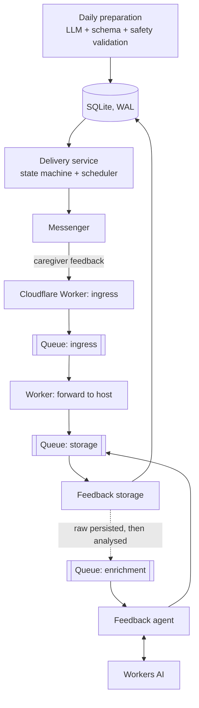

# Game of the Day

[](../../actions/workflows/ci.yml)
[](../../releases)

A small production service that sends a caregiver one safe, age-appropriate developmental activity for a young child every day, collects free-form feedback in a messenger, and turns it into structured observations for future personalization.

It runs in production for real families (VK and a Telegram bot, invite-only). It is also a worked answer to one question: **how do you put LLMs into a production workflow without letting them own state, side effects, or safety?**

> Not a medical or diagnostic product.

## What is interesting here

| Problem | How it is solved |
|---|---|
| LLM output is probabilistic, but delivery must be exactly-once | The LLM only *proposes*. Deterministic code owns the delivery state machine (`pending → sending → sent / failed`), dates, idempotency, and retries. |
| An unsafe activity must never reach a child | Two lines: a deterministic gate (schema, age-banded skills, hazardous terms, duplicates), then a small model that reviews safety against an age checklist. A rejection reaches the corrective retry with its reasons; nothing passes silently. |
| A model outage or an exhausted quota must not cost the family a day | Primary model → cheaper fallback model under the same gate → a validated game from the library, chosen by code; a daily model budget; the owner is told which path made the day. |
| Model outage must not lose user input | Raw feedback is persisted **before** any model call and crosses a durable queue boundary. A model failure leaves feedback retryable, not lost. |
| Personalization without giving the model memory | A small model only extracts observations from feedback, each with a verbatim quote checked by code; code builds the child's profile; the selection prompt follows it; evals score profile fit. |
| The model must not invent evidence | Feedback is segmented deterministically first. The model classifies the application's segments; it cannot create its own evidence spans. Unresolved references stay unresolved instead of being guessed. |
| Prompt and model changes regress silently | Eval suites: deterministic segmentation evals on every push, LLM evals against real Workers AI models on demand, with side-by-side model comparison. |
| "It ran" is not "the user got the game" | An independent daily-outcome check verifies that today's activity actually exists and was delivered, separately from the per-process alerts. |
| Onboarding without the operator | Telegram: a one-time invite link to the product bot. VK: anyone who writes to the community fills the same questionnaire in the chat, and the owner approves the application with one button in the ops bot, so a stranger cannot start model spending. Either way the family enters the birth date itself; the age is computed, confirmed and stored. No model is involved. |
| Parents should see the point | A Sunday digest: the week's games and skills, what went well from feedback, one or two home ideas for next week (deliberately no age norms: they read as a test parents can fail), and a monthly question about what is missing. |
| Small moments matter | A deterministic greeting on the child's month-birthdays in the first year, then on birthdays and half-birthdays, put before that day's game; end-of-month and leap-day births handled. |
| "Is it actually useful?" | Product metrics against the previous period: share of games with a written answer, liked, too easy / too hard (falling "too easy" means personalization works), pauses, wishes. |
| "Is the model getting worse or more expensive?" | Every model attempt is recorded (latency, tokens, cost, outcome, the validator's rejection reasons); a weekly report and `/llm` in the ops bot compare models on real runs. |
| Ops for a one-person service | systemd units with hardening, verified SQLite backups with retention and alerting, an owner-only Telegram bot for manual send/retry. |

## Architecture



- **Host runtime** (Python, systemd, SQLite): game preparation, delivery, feedback storage, backups, the daily outcome check, and the ops bot.
- **Edge** (Cloudflare Workers + Queues): callback validation, durable hand-off to the host, and the semantic feedback agent on Workers AI.
- Feedback goes through three separate queues (ingress, storage, enrichment). The storage queue carries both the raw event and, later, its analysis.

Details: [Deployment](docs/deployment.md) · [Architecture](docs/architecture.md) · [Decisions (ADR)](docs/adr/) · [Reliability model](docs/reliability.md) · [SLOs](docs/slo.md) · [Scaling](docs/scaling.md) · [AI design](docs/ai-design.md) · [Product roadmap](docs/product-roadmap.md)

## Where AI is used, and where it is not

**Deterministic code owns:** authentication and routing, workflow state, dates and delivery windows, persistence and record linking, idempotency, retries and recovery, schema and business validation, policy decisions, and every external side effect.

**LLMs are used for:**
- **Daily preparation:** proposing an activity candidate as structured output. It is then validated, and retried with the reasons if rejected ([`src/preparation`](src/preparation)).
- **Feedback insights:** a small model extracts observations with verbatim quotes; code builds the child's profile ([`src/feedback`](src/feedback)).
- **Feedback agent:** classifying free-form caregiver feedback and resolving which activity it refers to, inside an application-controlled candidate space ([`worker/src/agents`](worker/src/agents)). Production model: `@cf/google/gemma-4-26b-a4b-it` on Workers AI.

```text
feedback text
→ deterministic segmentation and provenance
→ AI classification of existing segments
→ deterministic validation
→ deterministic policy
→ guarded target linking
```

## Testing and evals

| Suite | What it covers | Runs |
|---|---|---|
| `tests/` (Python, 253 tests) | delivery state machine, feedback storage idempotency, preparation validation and message layout, child age, model backends, backup script, outcome check, ops bot, multi-child, product bot onboarding | every push (CI) |
| `worker/evals/runSegmentationEvals.js` | deterministic segmentation and relation detection | every push (CI) |
| `worker/evals/feedbackCases.js` (16 cases) | end-to-end semantic feedback analysis against a real model; compares `baseline` / `gemma` / `glm` | manual workflow ([LLM evals](.github/workflows/llm-evals.yml)) |
| `evals/preparation/` (6 synthetic cases) | the real selection path (prompt → model → validator → retries) scored by the gate, deterministic lint and an optional model judge; compares models (e.g. Opus vs Sonnet) | manual, on the host (spends quota) |
| ShellCheck | backup scripts | every push (CI) |

LLM evals are manual on purpose. The project has a strict no-unplanned-spend policy: running out of free quota must degrade safely, never switch on paid overage.

## Running locally

```bash
# Python unit tests (install the sqlite3 CLI to run the backup tests too)
python3 -m unittest discover -s tests -v

# Worker: deterministic evals
cd worker
npm ci
npm test

# Worker: LLM evals against Workers AI (needs a Cloudflare account)
npm run evals:llm:dev            # wrangler dev --remote with the evals config
curl "http://127.0.0.1:8787/__evals/feedback?model=baseline"
```

Configuration lives in environment variables; see [`.env.example`](.env.example). Worker secrets are set with `wrangler secret put`.

## Repository layout

```text
src/
  preparation/   daily activity generation: prompt, output schema, safety validation, retry
  delivery/      delivery state machine and messenger sender
  feedback/      queue consumer, idempotent storage, insights and the child profile
  ops/           daily outcome check, owner-only Telegram bot, alert notifier
  bot/           product Telegram bot: invites, onboarding, feedback
  db/            schema, additive migrations, children and recipients
worker/
  src/           Cloudflare Worker: callback ingress and the feedback agent
  evals/         deterministic and LLM eval suites
ops/             systemd units, timers and runbooks (preparation, delivery, feedback, backup, bot, outcome check)
evals/           selection evals and model comparison reports
docs/            architecture, reliability, AI design, deployment, roadmap, postmortems
legacy/          the original Google Apps Script sender (reference only)
```

Runbooks: [database backup](ops/backup/README.md) · [manual delivery control](ops/bot/README.md) · [daily outcome check](ops/day-outcome/README.md) · [product bot](ops/product-bot/README.md)

## In production

- In daily use since 2026-09-01; several families on VK and Telegram.
- In October the only host was lost together with its database. The service was rebuilt from this repository in one night, with the history recovered from the messenger and nothing re-sent ([postmortem](docs/postmortems/2026-10-host-loss.md)); backups now leave the host encrypted and are restore-tested weekly.
- Selection runs on Claude Sonnet in headless Claude Code, chosen over Opus by the [selection evals](evals/preparation/reports/2026-11-08-comparison.md); Haiku and a library of validated games are the fallback.

## Status

- Done and next: [roadmap](docs/product-roadmap.md). Known gaps are documented, not hidden: [reliability model](docs/reliability.md).

Changes are released as tagged versions with notes from the [changelog](CHANGELOG.md). Issue numbers like `#27` in older docs and commits refer to a private tracker (it contains production operational details).

## How this is built

One maintainer and an AI coding agent (Claude Code). The maintainer owns the product, the
architecture, the trade-offs and every production deploy; the agent implements under
narrow permissions, CI, evals and a deploy script with rollback. This is why parts of the
history move at minutes per commit. The same rule as in the product applies: the
probabilistic part proposes, deterministic checks and a human decide.
[Development process](docs/development-process.md) · [ADRs](docs/adr/)

## Engineering principles

- Keep state, guardrails and side effects deterministic.
- Persist user input before optional AI processing.
- Design idempotency, retries, recovery and rollback explicitly.
- Prefer observable failure over silent recovery.
- Add agents, frameworks or model routing only when they solve a demonstrated problem.
- Treat merge, deploy and production verification as separate readiness stages.

## License

[MIT](LICENSE). Real production identifiers, credentials, and family data are not part of this repository; see [SECURITY.md](SECURITY.md).
