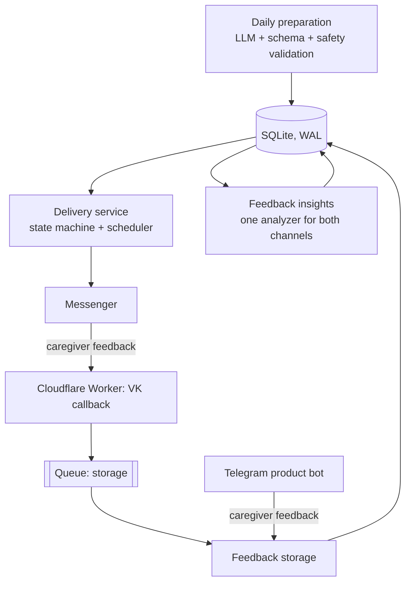

# Game of the Day

[](../../actions/workflows/ci.yml)
[](../../releases)

A small production service that sends a caregiver one safe, age-appropriate developmental activity for a young child every day, collects free-form feedback in a messenger, and turns it into structured observations for future personalization.

It runs in production for real families (VK and a Telegram bot, invite-only). It is also a worked answer to one question: **how do you put LLMs into a production workflow without letting them own state, side effects, or safety?**

> Not a medical or diagnostic product.

## What is interesting here

| Problem | How it is solved |
|---|---|
| LLM output is probabilistic, but a family must not get the same game twice or lose a day silently | The LLM only *proposes*. Deterministic code owns the delivery state machine (`pending → sending → sent / failed`), dates, idempotency, and retries. A crash between the messenger call and the database write is the hard case: in VK the stable `random_id` lets code check the dialog history, so the delivery ends `sent` or `failed` without a second message (effectively exactly-once); a Telegram bot cannot read its own history, so there it is at-most-once: never sent twice, and an unverifiable send is reported to the owner instead of guessed. |
| An unsafe activity must not reach a child | Two independent lines: a deterministic gate (schema, age-banded skills, hazardous terms, duplicates), then a small model that reviews safety against an age checklist. A rejection reaches the corrective retry with its reasons; nothing passes silently. The residual risk is real and named: the term list is finite and the reviewer is itself a model, so a hazard neither of them knows can pass. Every game is written for an adult doing it with the child and states its own hazards and when to stop; the reserve library holds only games validated in advance. |
| A model outage or an exhausted quota must not cost the family a day | Primary model → cheaper fallback model under the same gate → a validated game from the library, chosen by code; a daily model budget; the owner is told which path made the day. |
| Model outage must not lose user input | Raw feedback is persisted **before** any model call and crosses a durable queue boundary. A model failure leaves feedback retryable, not lost. |
| Personalization without giving the model memory | A small model only extracts observations from feedback, each with a verbatim quote checked by code; code builds the child's profile; the selection prompt follows it; evals score profile fit. |
| The model must not invent evidence | Every observation carries a quote, and code keeps it only if the quote is verbatim in the parent's message. One analyzer reads feedback from both channels ([ADR 0005](docs/adr/0005-one-feedback-analyzer.md)). |
| Prompt and model changes regress silently | Selection evals run the real selection path on demand, with side-by-side model comparison (they moved selection from Opus to Sonnet on evidence); every production model attempt is recorded. |
| "It ran" is not "the user got the game" | An independent daily-outcome check verifies that today's activity actually exists and was delivered, separately from the per-process alerts. |
| Onboarding without the operator | Telegram: a one-time invite link to the product bot. VK: anyone who writes to the community fills the same questionnaire in the chat, and the owner approves the application with one button in the ops bot, so a stranger cannot start model spending. Either way the family enters the birth date itself; the age is computed, confirmed and stored. No model is involved. |
| Answering must take a second | One-tap buttons under every game (liked / didn't, easy / just right / hard, and why it didn't work), a voice message transcribed to text (the audio is never kept), a reply to a game in VK or Telegram attaches to that game. Every message is acknowledged at once and answered with what was taken into account within minutes. |
| Parents should see the point | A Sunday digest: the week's games and skills, what went well from feedback, one or two home ideas for next week (deliberately no age norms: they read as a test parents can fail), and a monthly question about what is missing. |
| Small moments matter | A deterministic greeting on the child's month-birthdays in the first year, then on birthdays and half-birthdays, put before that day's game; end-of-month and leap-day births handled. |
| "Is it actually useful?" | Product metrics against the previous period: share of games with a written answer, liked, too easy / too hard (falling "too easy" means personalization works), pauses, wishes. |
| "Is the model getting worse or more expensive?" | Every model attempt is recorded (latency, tokens, cost, outcome, the validator's rejection reasons); a weekly report and `/llm` in the ops bot compare models on real runs. |
| Ops for a one-person service | systemd units with hardening, verified SQLite backups with retention and alerting, an owner-only Telegram bot for manual send/retry. |

## Architecture



- **Host runtime** (Python, systemd, SQLite): game preparation, delivery, feedback storage, backups, the daily outcome check, and the ops bot.
- **Edge** (Cloudflare Workers + Queues): VK callback validation and a durable hand-off to the host. The Worker makes no model call.
- VK feedback crosses one durable queue; Telegram feedback is stored by the product bot directly. Both land in the same table and are analysed by the same code.

Details: [Deployment](docs/deployment.md) · [Architecture](docs/architecture.md) · [Decisions (ADR)](docs/adr/) · [Reliability model](docs/reliability.md) · [SLOs](docs/slo.md) · [Scaling](docs/scaling.md) · [AI design](docs/ai-design.md) · [Product roadmap](docs/product-roadmap.md)

## Where AI is used, and where it is not

**Deterministic code owns:** authentication and routing, workflow state, dates and delivery windows, persistence and record linking, idempotency, retries and recovery, schema and business validation, policy decisions, and every external side effect.

**LLMs are used for:**
- **Daily preparation:** proposing an activity candidate as structured output. It is then validated, and retried with the reasons if rejected ([`src/preparation`](src/preparation)).
- **Feedback insights:** a small model extracts observations with verbatim quotes; code builds the child's profile ([`src/feedback`](src/feedback)).
- **Safety review:** a small model reviews each activity that passed the deterministic gate against an age checklist; a missing caution is added to the game's safety text, a hazard in the activity itself rejects it.
- **Voice feedback:** Whisper on Cloudflare Workers AI turns a voice message into text, called from the host; only the text is kept.

The Cloudflare Worker makes no model call: VK and Telegram feedback reach the same analyzer on the host ([ADR 0005](docs/adr/0005-one-feedback-analyzer.md)).

## Testing and evals

| Suite | What it covers | Runs |
|---|---|---|
| `tests/` (Python, 450+ tests) | delivery state machine, feedback storage idempotency, preparation validation and message layout, child age, model backends, backup script, outcome check, ops bot, multi-child, product bot onboarding | every push (CI) |
| `worker/tests/` | VK callback routing (private dialogs only, sender passed on) and reaction labels | every push (CI) |
| `tests/` on a shifted clock | the same suite a year ahead and on a leap-day midnight (libfaketime): a test that silently depends on today's date fails in the pull request | every push (CI) |
| `evals/preparation/` (20 synthetic cases, `--repeat`) | the real selection path (prompt → model → validator → reviewer → retries) scored by the gate, deterministic lint and a model judge, with the spread across repeats; atypical inputs and a prompt injection through a parent's quote; compares models (e.g. Opus vs Sonnet) | manual, on the host (spends quota) |
| `evals/safety/` (27 hand-labelled activities) | both safety lines against known answers: unsafe stopped, safe blocked, verdict stability, and whether the model or a code rule decided each block | manual, on the host (spends quota) |
| ShellCheck | backup and deploy scripts | every push (CI) |

Latest results: 60/60 selection runs passed the gate, the injection had no effect in 3/3 runs, and the two safety lines together stopped 15/15 unsafe activities; the weak spots are named too ([summary](evals/preparation/reports/2026-11-18-summary.md)).

LLM evals are manual on purpose. The project has a strict no-unplanned-spend policy: running out of free quota must degrade safely, never switch on paid overage.

## Running locally

```bash
# Python unit tests (install the sqlite3 CLI to run the backup tests too,
# and Pillow for the album tests: apt install python3-pil or pip install pillow)
python3 -m unittest discover -s tests -v

# Worker tests
cd worker
npm ci
npm test
```

Configuration lives in environment variables; see [`.env.example`](.env.example). Worker secrets are set with `wrangler secret put`.

## Repository layout

```text
src/
  preparation/   daily activity generation: prompt, output schema, safety validation, retry
  delivery/      delivery state machine, messenger sender, game cards, birthday greetings
  feedback/      queue consumer, idempotent storage, insights and the child profile
  ops/           outcome check, ops bot, alerts, reports, SLOs, digest, album, retention
  bot/           product Telegram bot: invites, onboarding, feedback
  db/            schema, additive migrations, children and recipients
worker/
  src/           Cloudflare Worker: VK callback ingress
  tests/         routing and reaction-label tests
assets/          card pictures and the album font (Nunito, SIL OFL)
ops/             systemd units, timers and runbooks (preparation, delivery, feedback, backup, bot, outcome check)
evals/           selection and safety evals, model comparison reports
docs/            architecture, reliability, AI design, deployment, roadmap, postmortems
legacy/          the original Google Apps Script sender (reference only)
```

Runbooks: [database backup](ops/backup/README.md) · [manual delivery control](ops/bot/README.md) · [daily outcome check](ops/day-outcome/README.md) · [product bot](ops/product-bot/README.md)

## In production

- In daily use since 2026-09-01; several families on VK and Telegram.
- In October the only host was lost together with its database. The service was rebuilt from this repository in one night, with the history recovered from the messenger and nothing re-sent ([postmortem](docs/postmortems/2026-10-host-loss.md)); backups now leave the host encrypted and are restore-tested weekly.
- Selection runs on Claude Sonnet in headless Claude Code, chosen over Opus by the [selection evals](evals/preparation/reports/2026-11-08-comparison.md); Haiku and a library of validated games are the fallback.

## Status

- Done and next: [roadmap](docs/product-roadmap.md). Known gaps are documented, not hidden: [reliability model](docs/reliability.md).

Changes are released as tagged versions with notes from the [changelog](CHANGELOG.md). Issue numbers like `#27` in older docs and commits refer to a private tracker (it contains production operational details).

## How this is built

One maintainer and an AI coding agent (Claude Code). The maintainer owns the product, the
architecture, the trade-offs and every production deploy; the agent implements under
narrow permissions, CI, evals and a deploy script with rollback. This is why parts of the
history move at minutes per commit. The same rule as in the product applies: the
probabilistic part proposes, deterministic checks and a human decide.
[Development process](docs/development-process.md) · [ADRs](docs/adr/)

## Engineering principles

- Keep state, guardrails and side effects deterministic.
- Persist user input before optional AI processing.
- Design idempotency, retries, recovery and rollback explicitly.
- Prefer observable failure over silent recovery.
- Add agents, frameworks or model routing only when they solve a demonstrated problem.
- Treat merge, deploy and production verification as separate readiness stages.

## License

[MIT](LICENSE). Real production identifiers, credentials, and family data are not part of this repository; see [SECURITY.md](SECURITY.md).
