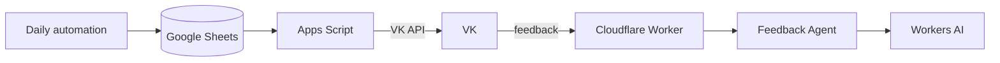
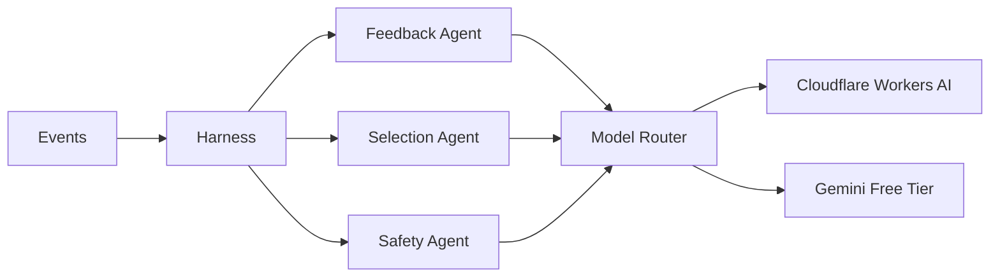

# Игра дня

Персональный сервис, который ежедневно подбирает безопасную развивающую игру для ребёнка с учётом возраста, истории игр и обратной связи пользователя.

Проект одновременно используется как практический учебный стенд для разработки AI/agent-систем: от детерминированной автоматизации и webhook-архитектуры до Harness, специализированных AI-агентов, model routing, structured output и eval.

## Статус проекта

**MVP v1 работает end-to-end:**

`подбор игры → Google Sheets → Google Apps Script → VK`

Также готов входящий транспорт обратной связи:

`VK Callback → Cloudflare Worker → validation/routing`

Cloudflare Workers AI подключён, первый inference успешно выполнен. Текущая разработка — **Feedback Agent v1**: семантический анализ обратной связи и structured output.

- [Архитектура проекта](docs/architecture.md) — текущая и целевая архитектура, Mermaid-диаграммы, границы deterministic/AI, Harness, Agents и Model Router.
- [GitHub Issues](../../issues) — backlog, приоритеты, текущие и выполненные задачи.

## Правила продукта

Игра должна:

- соответствовать текущему возрасту ребёнка;
- быть безопасной;
- развивать один из целевых навыков: речь, координацию или мелкую моторику;
- занимать примерно 5–10 минут;
- не повторять ранее использованную механику без явного запроса;
- иметь проверяемый первичный источник;
- не использовать мелкие опасные предметы, острые/хрупкие или токсичные материалы, горячие предметы/жидкости и сценарии с риском падения.

При сомнении в безопасности игра отклоняется.

## Архитектура — кратко



Целевое направление:



Подробные sequence/state diagrams и ответственность компонентов вынесены в [`docs/architecture.md`](docs/architecture.md).

Ключевой принцип:

> **AI failure != product failure**

Недоступность модели не должна останавливать доставку ежедневной игры; необработанная обратная связь сохраняется и может быть обработана позже.

## Бесплатность AI

Для проекта принято ограничение: **используем только бесплатные AI-решения / free-tier квоты**.

Текущий runtime — Cloudflare Workers AI. В backlog есть eval Cloudflare Workers AI vs Gemini Free Tier и других бесплатных кандидатов по качеству, structured output, latency, расходу quota и эксплуатационной сложности.

## Структура репозитория

```text
game-of-the-day/
├── docs/
│   └── architecture.md
├── src/
│   └── sendGameOfTheDay.js
├── worker/
│   ├── src/
│   │   └── index.js
│   ├── package.json
│   ├── package-lock.json
│   └── wrangler.jsonc
├── experiments/
│   ├── analyzeFeedback.js
│   ├── package.json
│   └── package-lock.json
├── README.md
└── .gitignore
```

## Security

Секреты и API-токены не хранятся в Git.

- VK access token — Google Apps Script Script Properties;
- VK Callback secret — Cloudflare secret;
- TEST/PROD peer IDs — Cloudflare secrets;
- внешние AI API keys, если появятся, — только secret store провайдера/runtime.

Worker не должен логировать peer ID, полный текст пользовательского сообщения или секреты.

## Engineering principles

- deterministic code для строгих правил, state и guardrails;
- LLM для семантических и неоднозначных решений;
- structured AI output валидируется приложением;
- LLM не является памятью системы;
- модели передаётся минимально необходимый context;
- retry и idempotency проектируются явно;
- AI-компоненты сравниваются на собственном eval-наборе;
- основной продукт продолжает работать при деградации AI.
