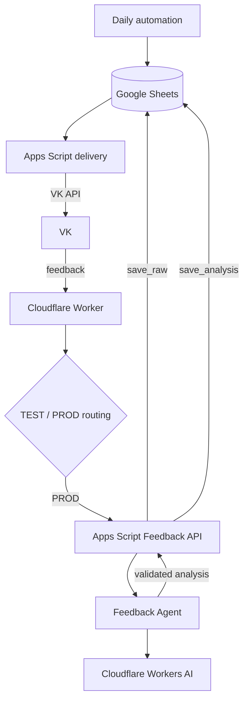
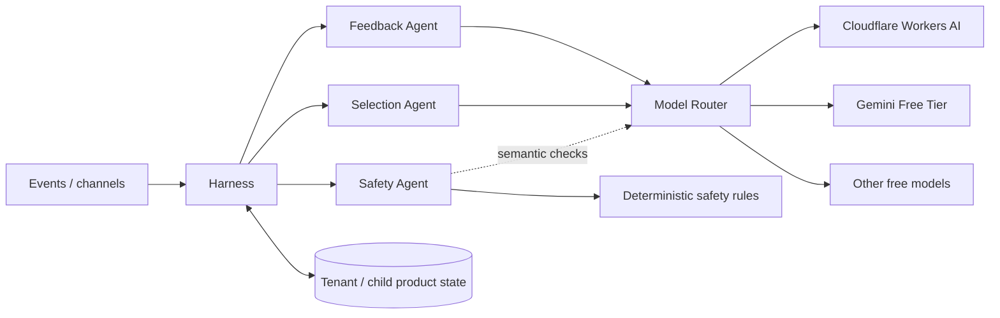

# Игра дня

Персональный сервис, который ежедневно подбирает безопасную развивающую игру для ребёнка с учётом возраста, истории игр, обратной связи пользователя и, в целевом продукте, выбранного направления развития и целей ребёнка.

Проект одновременно используется как практический учебный стенд для разработки AI/agent-систем: от детерминированной автоматизации и webhook-архитектуры до специализированных AI-агентов, structured output, eval, provenance validation, Harness и model routing.

## Статус проекта

### Работает в production

**MVP delivery:**

```text
Daily automation
→ Google Sheets
→ Google Apps Script
→ VK
```

**Production feedback loop:**

```text
VK message_new
→ Cloudflare Worker
→ validation + TEST/PROD routing
→ Apps Script Feedback API: save_raw
→ Google Sheets K/L
→ Feedback Agent
→ Apps Script Feedback API: save_analysis
→ Google Sheets M/N
```

04.09.2026 production E2E подтверждён на реальном сообщении обратной связи.

Raw feedback сохраняется **до AI inference**, поэтому ошибка или недоступность модели не приводит к потере пользовательской ОС.

### Текущая разработка

Текущий P0 — **Feedback Agent v1.3: evidence-bound target / provenance validation** (#6).

Production run выявил, что v1.2 мог вернуть target из metadata игры, даже если этого target не было в `feedback.text`. Поэтому свободный `target` заменяется на `target_text`, который должен быть доказуемым фрагментом исходного текста и проверяется детерминированно приложением.

```text
feedback.text
→ LLM semantic extraction
→ target_text | null
→ deterministic provenance validation
→ resolveDecision()
→ optional later normalization to domain mechanic
```

Текущий критичный маршрут:

```text
#6 Feedback Agent v1.3 provenance
→ #14 Request feedback UX
→ #7 Clarification workflow
→ #8 Personalization
```

Следующий продуктовый слой:

```text
#21 Telegram
#22 selectable development focus / skills
#23 child development track
#24 goals & progress
```

#20 задаёт сквозное архитектурное ограничение: новые потоки должны быть tenant-, child- и channel-aware без преждевременной большой миграции.

- [Product roadmap](docs/product-roadmap.md) — source of truth по продуктовой эволюции и связям инициатив.
- [Архитектура проекта](docs/architecture.md) — source of truth по текущей и целевой архитектуре.
- [GitHub Issues](../../issues) — backlog, приоритеты, текущие и выполненные задачи.

## Продуктовое направление

Эволюция продукта:

```text
ежедневная полезная игра
→ продукт слушает пользователя
→ персональный подбор
→ трек развития ребёнка
→ история целей и прогресса
```

Целевая ценность:

> Родитель выбирает, что хочет развивать у ребёнка, получает подходящие безопасные занятия, отмечает фактический опыт и со временем видит историю занятий и собственные наблюдения о прогрессе.

Продукт не является медицинским или диагностическим инструментом и не должен делать выводы о норме, задержке или диагнозах.

## Правила продукта

Базовая игра должна:

- соответствовать текущему возрасту ребёнка;
- быть безопасной;
- соответствовать выбранному направлению/навыку, когда такой пользовательский фокус задан;
- занимать примерно 5–10 минут;
- не повторять ранее использованную механику без явного запроса;
- иметь проверяемый первичный источник;
- не использовать мелкие опасные предметы, острые/хрупкие или токсичные материалы, горячие предметы/жидкости и сценарии с риском падения.

При сомнении в безопасности игра отклоняется.

Текущие категории `речь / координация / мелкая моторика` считаются стартовыми элементами каталога, а не финальным hard-coded ограничением продукта (#22).

Целевая доменная иерархия:

```text
направление развития
→ навык
→ цель
→ связанные игры / активности
```

Age и safety остаются hard constraints и имеют приоритет над пользовательским выбором.

## Каналы

VK — текущий production channel.

Telegram (#21) — следующий полноценный канал доставки и feedback. Канал рассматривается как transport layer: история ребёнка, preferences, goals и progress должны быть общими и не зависеть от VK/Telegram peer.

Целевая граница:

```text
channel connection (VK | Telegram | ...)
→ recipient
→ tenant/family
→ child profile
→ shared product state
```

## Child profile / product memory

Целевая модель (#23):

```text
child profile
  ├── age / birth date
  ├── selected development focus
  ├── goals
  ├── game history
  ├── played / not played
  ├── ratings / feedback
  ├── parent observations
  └── achieved milestones / progress
```

Ключевые принципы:

- `played / not played` хранится отдельно от оценки игры;
- отсутствие feedback не считается негативной оценкой;
- наблюдение родителя — observation, а не медицинский вывод;
- child-specific state принадлежит `child_id`, а не каналу;
- смена канала или направления развития не должна сбрасывать историю;
- goal/progress должен быть объясним сохранёнными событиями и наблюдениями (#24).

## Архитектура — кратко



Целевое направление:



Подробные sequence/state diagrams, границы ответственности и текущее состояние компонентов находятся в [`docs/architecture.md`](docs/architecture.md). Продуктовые зависимости и roadmap — в [`docs/product-roadmap.md`](docs/product-roadmap.md).

## Feedback Agent

### v1.2

Использовал контракт:

```json
{
  "observations": [
    {
      "reaction": "POSITIVE | NEGATIVE",
      "target": "string | null"
    }
  ]
}
```

Eval baseline: **11/12 PASS**. Этого было достаточно для запуска production feedback loop, но production выявил недостаточную защиту от metadata-grounding.

### v1.3

Целевой контракт:

```json
{
  "observations": [
    {
      "reaction": "POSITIVE | NEGATIVE",
      "target_text": "exact substring from feedback.text | null"
    }
  ]
}
```

Application layer проверяет provenance до принятия decision.

```text
observations = []
→ NO_PREFERENCE

есть target_text = null
→ NEED_CLARIFICATION

все target_text подтверждены исходным текстом
→ PREFERENCE_DETECTED
```

Нормализация `target_text → mechanic` не входит в v1.3 и рассматривается как отдельный последующий этап.

## Надёжность feedback flow

- raw feedback сохраняется до AI;
- AI failure не удаляет K/L;
- повтор уже обработанного callback не вызывает повторный inference;
- event/message ID используется для idempotency;
- TEST peer не изменяет PROD journal;
- Worker отвечает VK до завершения фоновой обработки;
- strict product decision принимается deterministic application layer.

Ключевой принцип:

> **AI failure != product failure**

Недоступность модели не должна останавливать доставку ежедневной игры; необработанная обратная связь сохраняется и может быть обработана позже.

## Бесплатность AI

Для проекта действует ограничение: **используем только бесплатные AI-решения / free-tier quotas**.

Текущий runtime — Cloudflare Workers AI. В backlog находится сравнение с Gemini Free Tier и другими бесплатными кандидатами по:

- semantic accuracy;
- provenance/grounding accuracy;
- ambiguity handling;
- structured output reliability;
- latency;
- расходу free quota;
- operational complexity.

## Структура репозитория

```text
game-of-the-day/
├── docs/
│   ├── architecture.md
│   └── product-roadmap.md
├── src/
│   └── sendGameOfTheDay.js
├── worker/
│   ├── src/
│   │   ├── index.js
│   │   └── agents/
│   │       └── feedbackAgent.js
│   ├── evals/
│   │   ├── feedbackCases.js
│   │   ├── runFeedbackEvals.js
│   │   └── index.js
│   ├── package.json
│   ├── package-lock.json
│   ├── wrangler.jsonc
│   └── wrangler.evals.jsonc
├── README.md
└── .gitignore
```

`experiments/` используется локально для отдельных исследований и намеренно не считается частью production-структуры репозитория.

## Security

Секреты и API-токены не хранятся в Git.

- VK access token — Google Apps Script Script Properties;
- VK Callback secret — Cloudflare secret;
- TEST/PROD peer IDs — Cloudflare secrets;
- Apps Script Feedback API защищён отдельным shared secret;
- Feedback API URL хранится в runtime config/secret;
- будущие Telegram credentials — только secret store/runtime config;
- внешние AI API keys, если появятся, — только secret store провайдера/runtime.

Worker не должен логировать peer ID, полный текст пользовательского сообщения или секреты.

## Engineering principles

- deterministic code для строгих правил, state, provenance и guardrails;
- LLM для семантических и неоднозначных задач;
- structured AI output валидируется приложением;
- metadata может быть context, но не evidence;
- LLM не является памятью системы;
- модели передаётся минимально необходимый context;
- retry и idempotency проектируются явно;
- raw user input сохраняется до AI processing;
- AI-компоненты сравниваются на собственном eval-наборе;
- основной продукт продолжает работать при деградации AI;
- product state отделён от delivery channel;
- child-specific memory проектируется вокруг `child_id`, а не конкретного peer/channel.
