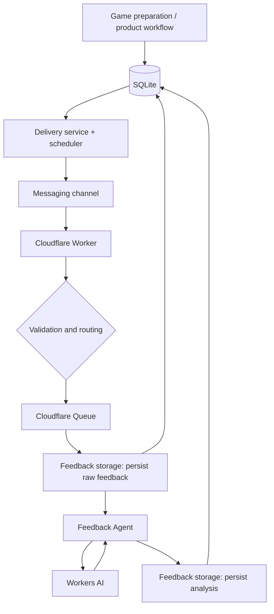

# Game of the Day

A small production-oriented service that delivers a safe, age-appropriate developmental activity each day and learns from caregiver feedback over time.

The project is also an engineering sandbox for reliable AI-assisted workflows: deterministic guardrails own state and side effects, while LLMs are limited to semantic tasks that benefit from them.

> **Project status:** production runs on the VPS/SQLite application runtime. Delivery and feedback have moved off the legacy Google runtime; the legacy path stays enabled only as a rollback, pending explicit retirement (see below).

## What the product does

The core loop is intentionally simple:

```text
child context + safety constraints + activity history
                    ↓
              daily activity
                    ↓
              delivery channel
                    ↓
                 feedback
                    ↓
       validated product observations
                    ↓
          future personalization
```

Activities are expected to be age-appropriate, safe, short enough for a daily routine, non-repetitive unless repetition is explicitly useful, and backed by a verifiable source.

This is **not** a medical or diagnostic product.

## Architecture

The target production architecture is:



The design deliberately separates delivery, feedback persistence, and final source-of-truth cutover so each boundary can be verified and rolled back independently.

See [Architecture](docs/architecture.md) for the detailed runtime model and migration invariants.

## Reliability model

A central design rule is:

> **AI failure must not become product failure.**

Raw feedback is persisted before AI processing. Long-running semantic analysis crosses a durable queue boundary. Duplicate external events are handled idempotently, retries are bounded, and workflow state remains application-owned.

Delivery uses explicit states such as `pending`, `sending`, `sent`, and `failed`. Repeated scheduler executions must be safe, and ambiguous failure states must be recoverable without uncontrolled duplicate delivery.

See [Reliability model](docs/reliability.md) for the invariants and the known gaps between them and the running system.

Operational runbooks live next to their code: [database backup](ops/backup/README.md), [manual delivery control](ops/bot/README.md), and [daily outcome check](ops/day-outcome/README.md).

## Deterministic / AI boundary

The application intentionally avoids delegating workflow ownership to an LLM.

**Deterministic code owns:**

- security and routing validation;
- persistence and record linking;
- workflow state transitions;
- idempotency, retry, and recovery;
- dates and delivery windows;
- provenance and schema validation;
- policy decisions and external side effects.

**AI is used for:**

- semantic classification of free-form feedback;
- interpretation of ambiguous reactions;
- constrained semantic target resolution;
- future recommendation steps where deterministic ranking is insufficient.

LLM output is structured and validated before it can affect durable state.

See [AI design](docs/ai-design.md) for the guardrails.

## Feedback Agent

The semantic feedback path follows a provenance-preserving contract:

```text
feedback text
→ deterministic segmentation and provenance
→ AI classification of existing segments
→ deterministic validation
→ deterministic policy
→ guarded target linking
```

The model does not invent evidence spans. Metadata may provide context but is not treated as user evidence. Unresolved targets remain unresolved instead of being guessed.

The current production model is `@cf/google/gemma-4-26b-a4b-it` through Cloudflare Workers AI.

## Current migration

Delivery and feedback state have moved from the legacy Google runtime to SQLite on the application host — this describes how the product runs today, not a plan in progress.

```text
production-safe delivery state machine
        +
reproducible scheduler
        +
idempotent feedback storage
        +
Cloudflare → application persistence
        +
observability and recovery checks
        ↓
controlled production cutover
        ↓
stability period
        ↓
legacy runtime retirement
```

Status: daily preparation and delivery have run from the host every day since 2026-09-18 except 2026-09-20/21 (a validation bug, fixed in #44, not recurred since — ten clean days as of 2026-09-28). What remains before the migration epic (#27) closes is not technical capability, it is formally retiring the legacy path against the exit criteria the owner set in #32: the new outcome check green for 14 consecutive days (day 0 today; the recovery drill through it already succeeded once, on 2026-09-21) and a documented rollback to the legacy path tried at least once. Whether the legacy sender is even still enabled is a separate open question (#46). Migration and architecture refactoring are intentionally kept separate.

## Engineering principles

- Keep state, guardrails, and side effects deterministic.
- Persist user input before optional AI processing.
- Design idempotency, retries, recovery, and rollback explicitly.
- Keep product state independent from delivery transport.
- Prefer simple application flows over premature orchestration frameworks.
- Add agents or model-routing layers only when they solve a demonstrated problem.
- Keep secrets, production identifiers, user data, and infrastructure-specific details out of the repository.
- Treat merge, deploy, and production verification as separate readiness stages.
- Prefer observable failure modes over silent recovery.

## Product roadmap

Near-term product development focuses on completing the feedback UX, clarification workflow, and personalization. Later layers add selectable development focus, a channel-independent child activity history, goals/progress, and additional delivery channels.

See [Product Roadmap](docs/product-roadmap.md) and [GitHub Issues](../../issues) for the current execution backlog.

## Repository safety

Public documentation uses role-based names and placeholders instead of production hostnames, addresses, recipient identities, or credentials. Two categories still leak into tracked files as a known, tracked gap rather than a silent one: the operational unit files under `ops/` name the actual host service user and its filesystem path, and two legacy-path identifiers remain hardcoded in source. Both are pre-publication work (#34); the repository is private until they are resolved.

Runtime secrets must never be committed. See [Security Policy](SECURITY.md).

## Cost policy

The project currently has a strict no-unplanned-spend rule. Free-tier infrastructure and AI quotas may be used, but exhaustion of a free quota must degrade safely rather than automatically enabling paid overage.
