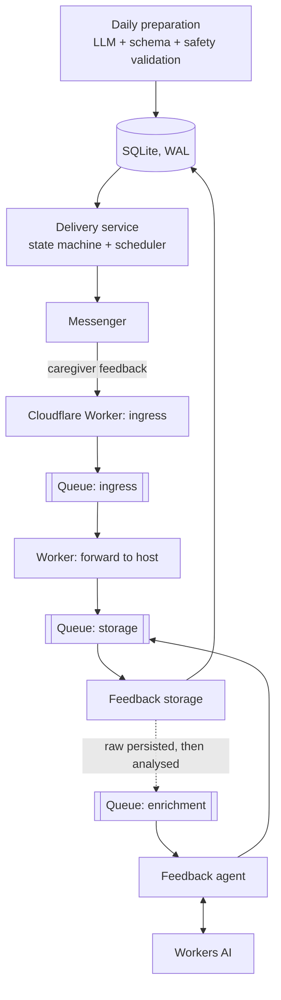

# Game of the Day

[](../../actions/workflows/ci.yml)

A small production service that sends a caregiver one safe, age-appropriate developmental activity for a young child every day, collects free-form feedback in a messenger, and turns it into structured observations for future personalization.

It runs in production for a real family. It is also an engineering sandbox for one question: **how do you put LLMs into a production workflow without letting them own state, side effects, or safety?**

> Not a medical or diagnostic product.

## What is interesting here

| Problem | How it is solved |
|---|---|
| LLM output is probabilistic, but delivery must be exactly-once | The LLM only *proposes*. Deterministic code owns the delivery state machine (`pending → sending → sent / failed`), dates, idempotency, and retries. |
| An unsafe activity must never reach a child | Generated candidates are validated against a JSON Schema and deterministic safety rules (for example, sharp-object hazards). A rejected candidate gets a corrective retry with the rejection reasons, never a silent pass. |
| Model outage must not lose user input | Raw feedback is persisted **before** any model call and crosses a durable queue boundary. A model failure leaves feedback retryable, not lost. |
| The model must not invent evidence | Feedback is segmented deterministically first. The model classifies the application's segments; it cannot create its own evidence spans. Unresolved references stay unresolved instead of being guessed. |
| Prompt and model changes regress silently | Eval suites: deterministic segmentation evals on every push, LLM evals against real Workers AI models on demand, with side-by-side model comparison. |
| "It ran" is not "the user got the game" | An independent daily-outcome check verifies that today's activity actually exists and was delivered, separately from the per-process alerts. |
| Ops for a one-person service | systemd units with hardening, verified SQLite backups with retention and alerting, an owner-only Telegram bot for manual send/retry. |

## Architecture



- **Host runtime** (Python, systemd, SQLite): game preparation, delivery, feedback storage, backups, the daily outcome check, and the ops bot.
- **Edge** (Cloudflare Workers + Queues): callback validation, durable hand-off to the host, and the semantic feedback agent on Workers AI.
- Feedback goes through three separate queues (ingress, storage, enrichment). The storage queue carries both the raw event and, later, its analysis.

Details: [Deployment](docs/deployment.md) · [Architecture](docs/architecture.md) · [Reliability model](docs/reliability.md) · [AI design](docs/ai-design.md) · [Product roadmap](docs/product-roadmap.md)

## Where AI is used, and where it is not

**Deterministic code owns:** authentication and routing, workflow state, dates and delivery windows, persistence and record linking, idempotency, retries and recovery, schema and business validation, policy decisions, and every external side effect.

**LLMs are used for:**
- **Daily preparation:** proposing an activity candidate as structured output. It is then validated, and retried with the reasons if rejected ([`src/preparation`](src/preparation)).
- **Feedback agent:** classifying free-form caregiver feedback and resolving which activity it refers to, inside an application-controlled candidate space ([`worker/src/agents`](worker/src/agents)). Production model: `@cf/google/gemma-4-26b-a4b-it` on Workers AI.

```text
feedback text
→ deterministic segmentation and provenance
→ AI classification of existing segments
→ deterministic validation
→ deterministic policy
→ guarded target linking
```

## Testing and evals

| Suite | What it covers | Runs |
|---|---|---|
| `tests/` (Python, 121 tests) | delivery state machine, feedback storage idempotency, preparation validation, backup script, outcome check, ops bot | every push (CI) |
| `worker/evals/runSegmentationEvals.js` | deterministic segmentation and relation detection | every push (CI) |
| `worker/evals/feedbackCases.js` (16 cases) | end-to-end semantic feedback analysis against a real model; compares `baseline` / `gemma` / `glm` | manual workflow ([LLM evals](.github/workflows/llm-evals.yml)) |
| ShellCheck | backup script | every push (CI) |

LLM evals are manual on purpose. The project has a strict no-unplanned-spend policy: running out of free quota must degrade safely, never switch on paid overage.

## Running locally

```bash
# Python unit tests (install the sqlite3 CLI to run the backup tests too)
python3 -m unittest discover -s tests -v

# Worker: deterministic evals
cd worker
npm ci
npm test

# Worker: LLM evals against Workers AI (needs a Cloudflare account)
npm run evals:llm:dev            # wrangler dev --remote with the evals config
curl "http://127.0.0.1:8787/__evals/feedback?model=baseline"
```

Configuration lives in environment variables; see [`.env.example`](.env.example). Worker secrets are set with `wrangler secret put`.

## Repository layout

```text
src/
  preparation/   daily activity generation: prompt, output schema, safety validation, retry
  delivery/      delivery state machine and messenger sender
  feedback/      queue consumer and idempotent feedback storage
  ops/           daily outcome check, owner-only Telegram bot, alert notifier
  db/            schema and one-off import/sync from the legacy sheet
worker/
  src/           Cloudflare Worker: callback ingress and the feedback agent
  evals/         deterministic and LLM eval suites
ops/             systemd units, timers and runbooks (backup, bot, outcome check, delivery retry)
docs/            architecture, reliability, AI design, roadmap
legacy/          the original Google Apps Script sender (rollback path)
```

Runbooks: [database backup](ops/backup/README.md) · [manual delivery control](ops/bot/README.md) · [daily outcome check](ops/day-outcome/README.md)

## Status

- Daily preparation and delivery have run on the host/SQLite runtime since 2026-09-18. The original Google Sheets + Apps Script runtime is kept only as a rollback path.
- The semantic feedback pipeline is in production. Next: feedback UX, a clarification workflow, and personalization from validated observations ([roadmap](docs/product-roadmap.md)).
- Known gaps are documented, not hidden. For example, an interrupted `sending` delivery is detected but still needs a manual decision ([reliability model](docs/reliability.md)).

Development is done through small PRs against an issue tracker. Issue numbers like `#27` in the docs and commit history refer to that tracker, which stays private because it contains production operational details.

## Engineering principles

- Keep state, guardrails and side effects deterministic.
- Persist user input before optional AI processing.
- Design idempotency, retries, recovery and rollback explicitly.
- Prefer observable failure over silent recovery.
- Add agents, frameworks or model routing only when they solve a demonstrated problem.
- Treat merge, deploy and production verification as separate readiness stages.

## License

[MIT](LICENSE). Real production identifiers, credentials, and family data are not part of this repository; see [SECURITY.md](SECURITY.md).
