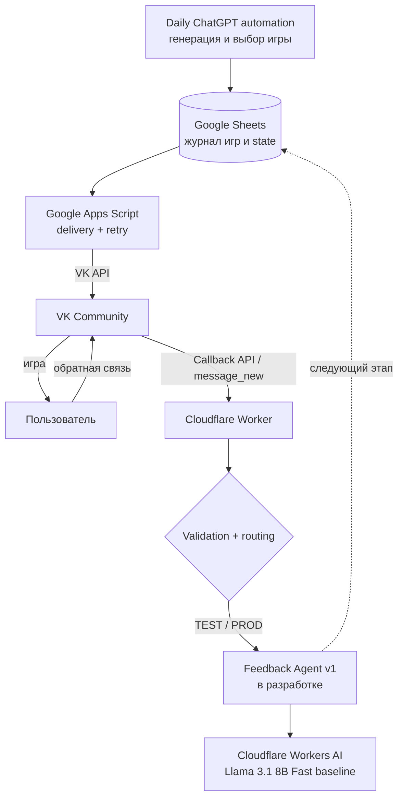
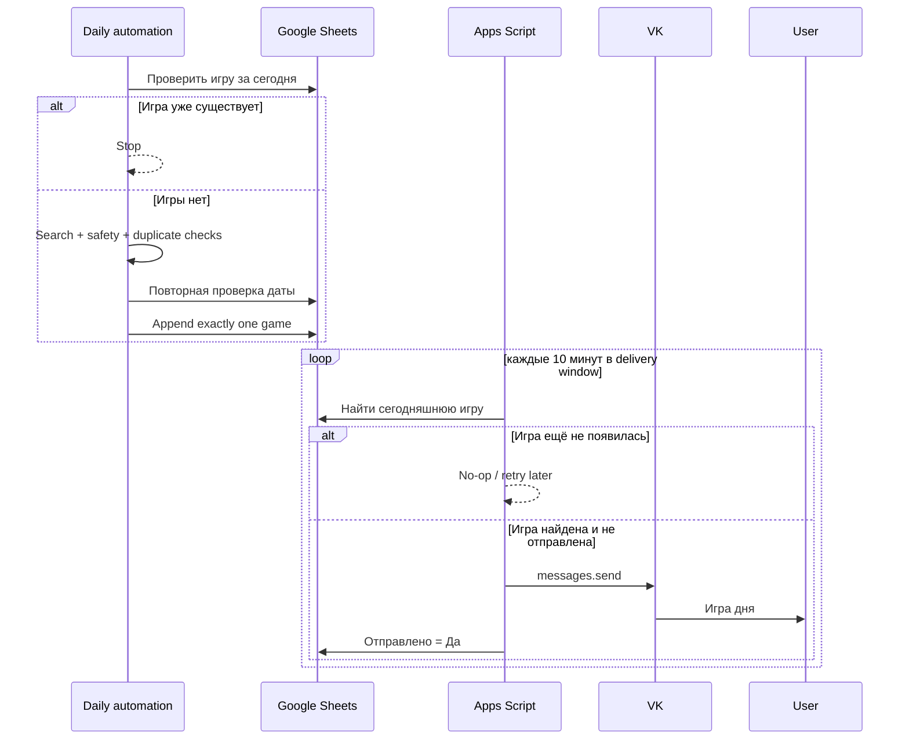
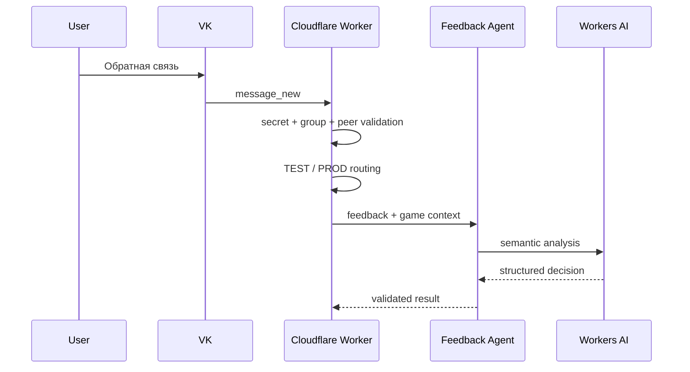
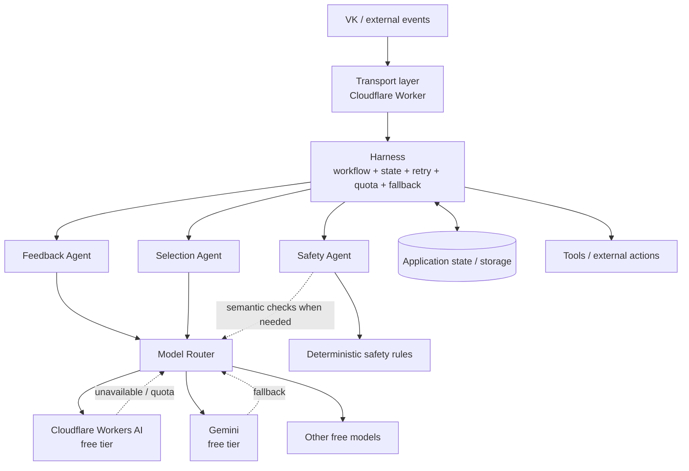
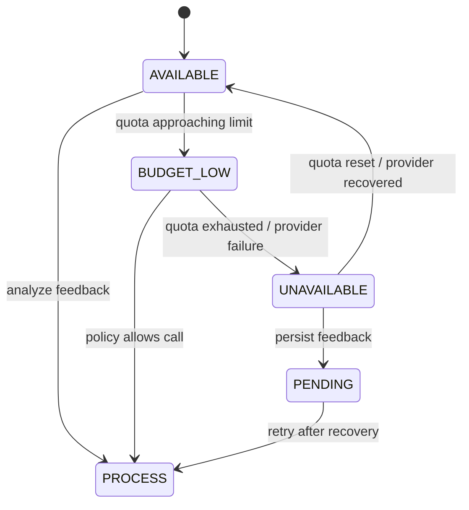
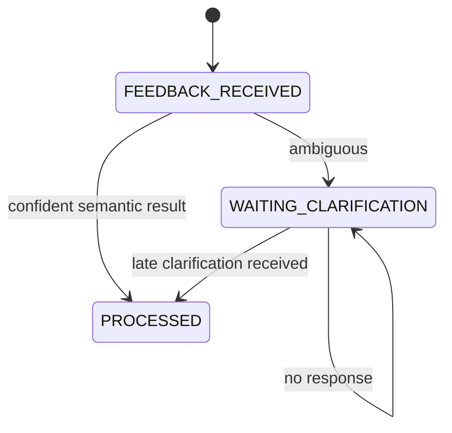

# Архитектура «Игра дня»

Этот документ — **source of truth по архитектуре проекта**. README содержит только обзор. Здесь отдельно описываются текущая реализованная архитектура и целевое направление развития.

> Важно: блоки в разделе «Целевая архитектура» не считаются реализованными, пока соответствующая задача не закрыта в GitHub Issues.

## 1. Текущая архитектура

MVP v1 работает end-to-end. Входящий транспорт обратной связи также работает. Feedback Agent v1 находится в разработке.



### Ответственность компонентов

| Компонент | Ответственность | Статус |
|---|---|---|
| Daily ChatGPT automation | Поиск, проверка истории, выбор и запись одной игры | Работает |
| Google Sheets | Журнал игр и текущее продуктовое состояние | Работает |
| Google Apps Script | Поиск сегодняшней игры, delivery window, retry, отправка VK | Работает |
| VK | Канал доставки игры и получения ОС | Работает |
| Cloudflare Worker | Callback ingress, validation, TEST/PROD routing | Работает |
| Workers AI binding | Runtime для бесплатной LLM | Работает |
| Feedback Agent | Семантический анализ ОС и structured output | In Progress |

## 2. Основные потоки

### 2.1 Генерация и доставка



### 2.2 Получение обратной связи — текущий этап



Связывание ОС с игрой, сохранение результата и clarification workflow — следующие задачи backlog.

## 3. Граница deterministic / AI

Принцип проекта: **LLM используется только там, где требуется семантическое или неоднозначное решение.**

### Deterministic code

- даты и временные окна;
- duplicate guards;
- routing TEST/PROD;
- authentication/validation callback;
- state machine;
- retry/idempotency;
- quota/fallback policy;
- сохранение данных;
- строгие safety guardrails, которые можно выразить правилами;
- выполнение внешних действий.

### AI / LLM

- понимание свободного текста ОС;
- выделение понравившихся/не понравившихся механик;
- обнаружение неоднозначности;
- формулирование clarification question;
- семантическое сравнение механик;
- дальнейшая персонализация выбора игр.

LLM не является памятью системы. Приложение хранит state и передаёт модели минимально необходимый context.

## 4. Feedback Agent v1

Первый специализированный AI-agent проекта.

Пример входа:

```json
{
  "game": {
    "id": "006",
    "title": "Башня из стаканчиков",
    "skill": "координация",
    "mechanic": "строительство башни"
  },
  "feedback": {
    "text": "Башня ему быстро надоела, зато очень понравилось складывать стаканчики друг в друга"
  },
  "known_preferences": []
}
```

Ожидаемый тип выхода:

```json
{
  "decision": "PREFERENCE_DETECTED",
  "liked_mechanics": ["вкладывание предметов друг в друга"],
  "disliked_mechanics": ["строительство башни"],
  "clarification_question": null
}
```

Для неоднозначной ОС агент должен вернуть `NEED_CLARIFICATION`, не создавая неподтверждённое negative preference.

## 5. Целевая мультиагентная архитектура

Harness — единый оркестратор workflow. Это преимущественно deterministic application layer, а не отдельная LLM.



### Harness

Отвечает за:

- выбор следующего шага workflow;
- state machine;
- маршрутизацию между агентами;
- retries;
- quota management;
- fallback;
- graceful degradation;
- принятие решения о выполнении внешнего действия.

### Agents

Каждый агент имеет узкую ответственность. Новый агент добавляется только если выделение отдельной интеллектуальной задачи даёт практическую пользу. Мультиагентность не является целью сама по себе.

### Model Router

Отделяет agent contract от конкретной модели/провайдера.

Целевая стратегия:

1. выбрать бесплатную модель, достаточную для задачи;
2. простые задачи выполнять лёгкой моделью;
3. escalation на более сильную бесплатную модель только при необходимости;
4. учитывать доступность и quota;
5. при невозможности inference вернуть Harness штатный статус недоступности, а не ломать workflow.

## 6. Graceful degradation

Ключевой архитектурный принцип:

> **AI failure != product failure**



Если AI недоступен:

- доставка ежедневной игры продолжает работать;
- входящая ОС не теряется;
- ОС остаётся pending/unprocessed;
- система может обработать её после восстановления модели;
- пользовательский UX при `BUDGET_LOW`/`UNAVAILABLE` определяется отдельной policy.

## 7. Clarification state

Неоднозначная ОС не должна превращаться в неподтверждённое preference.



`WAITING_CLARIFICATION` не блокирует следующую игру. Поздний ответ должен продолжать старый dialogue и влиять на будущие рекомендации.

## 8. Data / state

На текущем этапе Google Sheets содержит журнал игр и feedback-поля:

- ID;
- дата;
- возраст;
- название;
- навык;
- механика;
- источник;
- ссылка;
- текст для отправки;
- отправлено;
- обратная связь;
- время ОС;
- результат ОС;
- ОС обработана.

По мере появления Harness может потребоваться отдельное хранилище application state. Решение о миграции принимается по фактической сложности state, а не заранее.

## 9. AI cost policy

Проект использует **только бесплатные AI-решения / free-tier quotas**.

Текущий baseline: Cloudflare Workers AI. В backlog находится eval с Gemini Free Tier и другими бесплатными кандидатами.

Модель выбирается по измеримым характеристикам на собственном eval-наборе:

- semantic accuracy;
- ambiguity/clarification accuracy;
- structured output reliability;
- latency;
- расход free quota;
- operational complexity.

## 10. Security boundaries

- secrets не хранятся в Git;
- VK access token хранится в Apps Script Script Properties;
- callback secret и peer routing values — Cloudflare secrets;
- внешние AI keys, если появятся, — secret store runtime/provider;
- Worker валидирует callback до бизнес-обработки;
- неизвестные peer игнорируются;
- логи не должны содержать peer ID, полный feedback text или secrets;
- LLM не получает идентификаторы пользователя, если они не нужны для semantic task.

## 11. Эволюция архитектуры

Архитектура развивается инкрементально:

```text
MVP delivery
    ↓
Feedback ingress
    ↓
Feedback Agent
    ↓
Feedback persistence + linking
    ↓
Clarification workflow
    ↓
Personalization
    ↓
Harness extraction
    ↓
Additional specialized agents
    ↓
Model routing / multi-provider fallback
```

Актуальные implementation-задачи и их приоритеты ведутся в GitHub Issues.
