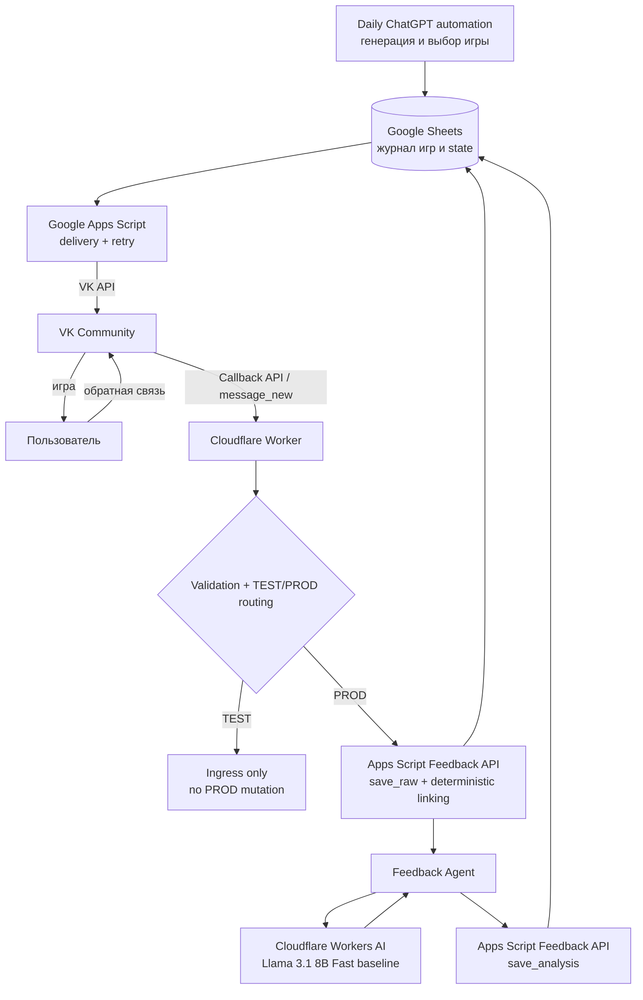
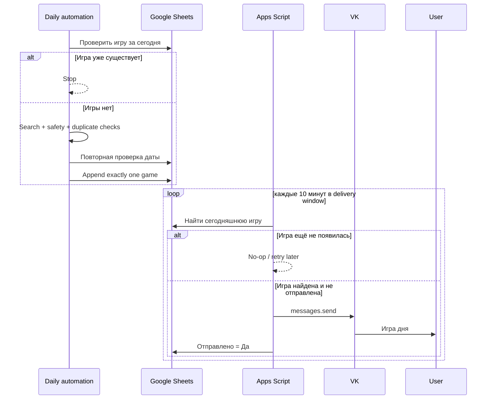
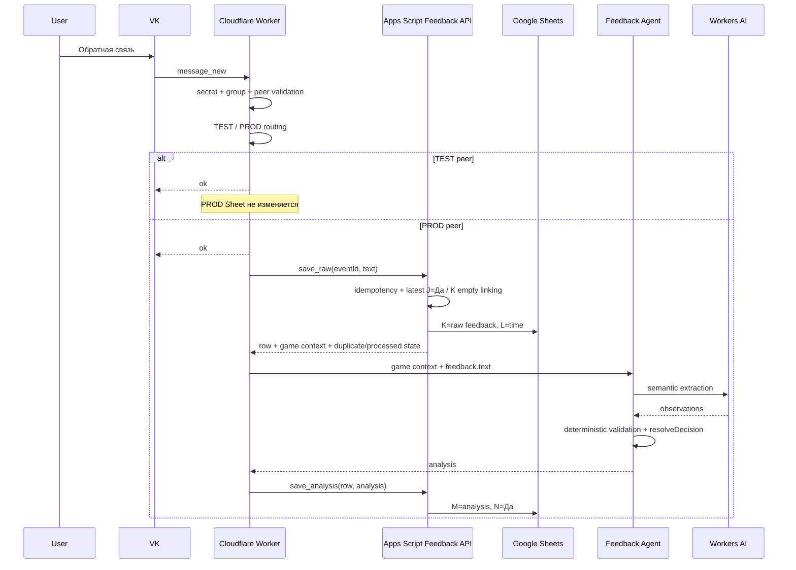
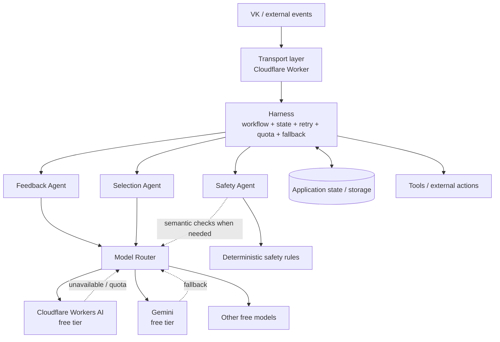
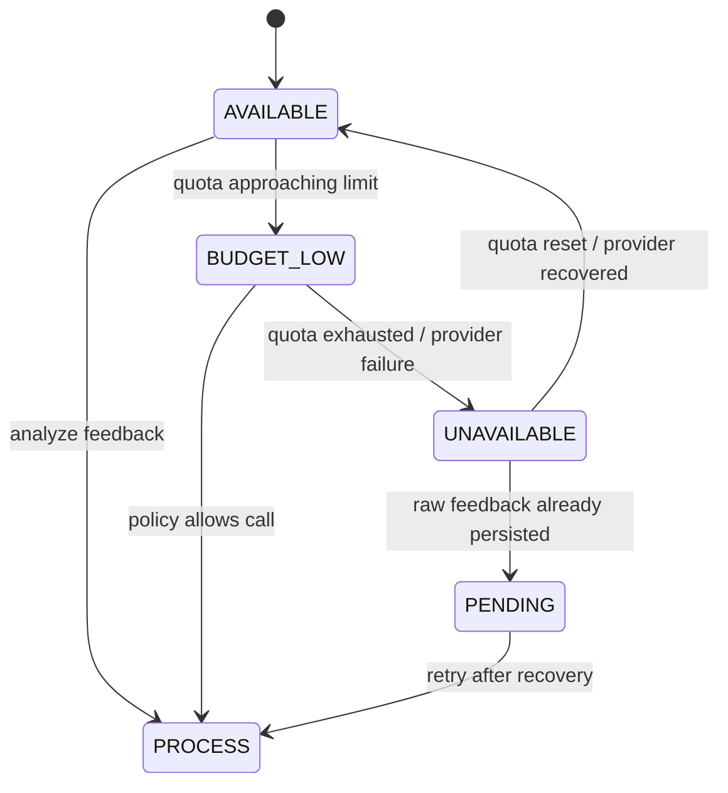
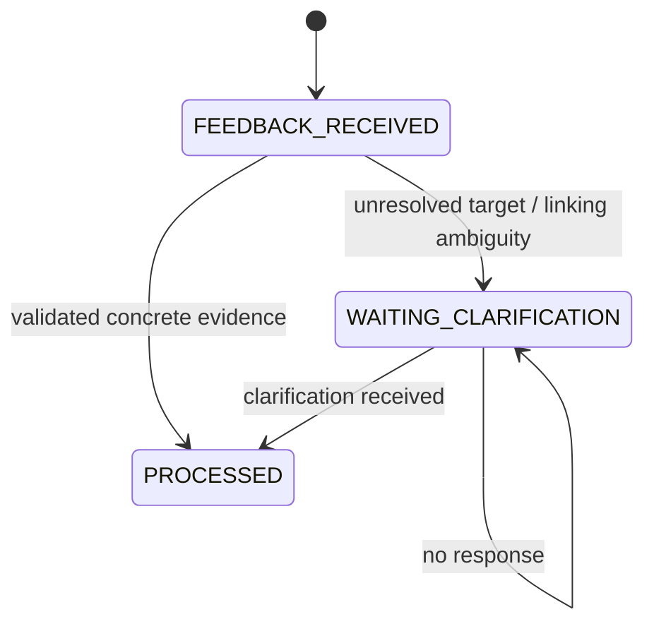

# Архитектура «Игра дня»

Этот документ — **source of truth по архитектуре проекта**. README содержит только обзор. Здесь отдельно описываются текущая реализованная архитектура и целевое направление развития.

> Важно: блоки в разделе «Целевая архитектура» не считаются реализованными, пока соответствующая задача не закрыта в GitHub Issues.

## 1. Текущая архитектура

MVP delivery и production feedback persistence/linking работают end-to-end. 04.09.2026 реальная PROD ОС прошла цепочку VK → Worker → Apps Script → Google Sheets → Feedback Agent → Google Sheets.

Production E2E одновременно выявил semantic grounding defect Feedback Agent v1.2: модель смогла вернуть target из metadata игры, хотя target отсутствовал в `feedback.text`. Поэтому transport/persistence #5 завершён, а Feedback Agent #6 переоткрыт для v1.3 evidence-bound contract.



### Ответственность компонентов

| Компонент | Ответственность | Статус |
|---|---|---|
| Daily ChatGPT automation | Поиск, проверка истории, выбор и запись одной игры | Работает |
| Google Sheets | Журнал игр, delivery state, raw ОС и результат анализа | Работает |
| Google Apps Script delivery | Поиск сегодняшней игры, delivery window, retry, отправка VK | Работает |
| Google Apps Script Feedback API | deterministic linking, idempotency, `save_raw`, `save_analysis` | Работает |
| VK | Канал доставки игры и получения ОС | Работает |
| Cloudflare Worker | Callback ingress, validation, TEST/PROD routing, orchestration feedback flow | Работает |
| Workers AI binding | Runtime для бесплатной LLM | Работает |
| Feedback Agent v1.2 | Семантический анализ ОС | Production defect; #6 reopened |

## 2. Основные потоки

### 2.1 Генерация и доставка



### 2.2 Production feedback flow — реализован



### Надёжность feedback flow

- raw feedback сохраняется до AI inference;
- AI failure не удаляет K/L;
- если AI/validation падает, M/N остаются незавершёнными и ОС можно обработать повторно;
- VK callback event/message id используется как idempotency key;
- повтор уже полностью обработанного события не вызывает повторный AI inference;
- TEST peer не мутирует PROD Sheet;
- Worker отвечает VK до завершения фоновой обработки через `waitUntil()`.

MVP linking выбирает самую свежую отправленную строку (`J = Да`) с пустой ОС (`K`). Ссылки на более старую игру остаются задачей cross-game linking / clarification (#7).

## 3. Граница deterministic / AI

Принцип проекта: **LLM используется только там, где требуется семантическое понимание текста. Системные решения, provenance validation и state остаются deterministic.**

### Deterministic code

- даты и временные окна;
- duplicate guards;
- routing TEST/PROD;
- authentication/validation callback;
- state machine;
- retry/idempotency;
- quota/fallback policy;
- linking feedback к строке игры;
- сохранение raw feedback и analysis;
- проверка provenance AI-output относительно исходного текста;
- `resolveDecision()` по validated observations;
- строгие safety guardrails, которые можно выразить правилами;
- выполнение внешних действий.

### AI / LLM

- понимание свободного текста ОС;
- извлечение положительной/отрицательной реакции ребёнка;
- указание textual evidence только когда оно присутствует в `feedback.text`;
- сохранение unresolved target, когда реакция есть, но textual evidence недостаточно;
- семантическое сравнение/нормализация подтверждённых targets на последующих этапах;
- дальнейшая персонализация выбора игр.

LLM не принимает product decision, не является памятью системы и не должен использовать metadata игры как evidence. Приложение хранит state, проверяет provenance и передаёт модели минимально необходимый context.

## 4. Feedback Agent: v1.2 → v1.3

### v1.2 — baseline, выявивший production defect

Контракт:

```json
{
  "observations": [
    {
      "reaction": "POSITIVE | NEGATIVE",
      "target": "string | null"
    }
  ]
}
```

Eval baseline: 11/12 PASS. Он был достаточен для запуска production feedback loop, но не гарантировал provenance свободного `target`.

04.09.2026 production feedback:

```text
Ребёнку понравилось, несколько раз сам повторял действие
```

привёл к target `Ладушки вместе`, взятому из game metadata. Это нарушает инвариант `metadata = context, not evidence`.

### v1.3 — принятый следующий контракт

LLM должен возвращать evidence-bound текст:

```json
{
  "observations": [
    {
      "reaction": "POSITIVE | NEGATIVE",
      "target_text": "exact substring from feedback.text | null"
    }
  ]
}
```

Application layer обязан детерминированно проверить:

```text
target_text == null
OR
target_text является подстрокой исходного feedback.text
```

Если provenance check не проходит, AI-result считается invalid и не должен превращаться в preference.

Decision после validation:

```text
observations = []
→ NO_PREFERENCE

есть observation с target_text = null
→ NEED_CLARIFICATION

все observations имеют валидный evidence-bound target_text
→ PREFERENCE_DETECTED
```

Ключевое разделение ответственности:

```text
feedback.text
    ↓
LLM: semantic extraction + textual evidence
    ↓
Deterministic provenance validation
    ↓
resolveDecision()
    ↓
optional later stage: target_text → normalized domain mechanic
```

Нормализация в механику не входит в v1.3. Это отдельная интеллектуальная задача после доказанного textual evidence.

## 5. Целевая мультиагентная архитектура

Harness — единый оркестратор workflow. Это преимущественно deterministic application layer, а не отдельная LLM.



### Harness

Отвечает за workflow, state machine, маршрутизацию между агентами, retries, quota management, fallback, graceful degradation и выполнение внешних действий.

Текущий Cloudflare Worker уже выполняет часть orchestration для feedback flow, но ещё не выделен в самостоятельный Harness abstraction.

### Agents

Каждый агент имеет узкую ответственность. Новый агент добавляется только если выделение отдельной интеллектуальной задачи даёт практическую пользу. Мультиагентность не является целью сама по себе.

### Model Router

Отделяет agent contract от конкретной модели/провайдера. Модель выбирается по качеству на собственном eval-наборе, доступности, latency, free quota и operational complexity.

## 6. Graceful degradation

Ключевой архитектурный принцип:

> **AI failure != product failure**



Если AI недоступен:

- доставка ежедневной игры продолжает работать;
- входящая ОС не теряется;
- ОС остаётся pending/unprocessed;
- система может обработать её после восстановления модели.

## 7. Clarification state

Неоднозначная ОС не должна превращаться в неподтверждённое preference.



`WAITING_CLARIFICATION` не блокирует следующую игру. Поздний ответ должен продолжать старый dialogue и влиять на будущие рекомендации.

## 8. Data / state

Google Sheets содержит журнал игр и feedback-поля:

- A ID;
- B дата;
- C возраст;
- D название;
- E навык;
- F механика;
- G источник;
- H ссылка;
- I текст для отправки;
- J отправлено;
- K raw обратная связь;
- L время ОС;
- M результат анализа;
- N ОС обработана.

Apps Script Script Properties также используются для feedback event idempotency mapping. По мере появления Harness может потребоваться отдельное хранилище application state. Решение о миграции принимается по фактической сложности state.

## 9. AI cost policy

Проект использует **только бесплатные AI-решения / free-tier quotas**.

Текущий baseline provider: Cloudflare Workers AI. В backlog находится eval с Gemini Free Tier и другими бесплатными кандидатами.

Модель выбирается по:

- semantic accuracy;
- provenance/grounding accuracy;
- ambiguity/clarification accuracy;
- structured output reliability;
- latency;
- расходу free quota;
- operational complexity.

## 10. Security boundaries

- secrets не хранятся в Git;
- VK access token хранится в Apps Script Script Properties;
- Apps Script Feedback API защищён отдельным shared secret;
- callback secret и peer routing values — Cloudflare secrets;
- внешний feedback API URL — Cloudflare secret/config;
- Worker валидирует callback до бизнес-обработки;
- неизвестные peer игнорируются;
- TEST peer не имеет права мутировать PROD feedback state;
- логи не должны содержать peer ID, полный feedback text или secrets;
- LLM не получает идентификаторы пользователя, если они не нужны для semantic task.

## 11. Эволюция архитектуры

```text
MVP delivery                         DONE
    ↓
Feedback ingress                    DONE
    ↓
Feedback Agent v1.2 baseline        DONE / superseded
    ↓
Feedback persistence + linking      DONE (#5)
    ↓
Feedback Agent v1.3 provenance      CURRENT (#6)
    ↓
Request feedback UX                 #14
    ↓
Clarification workflow              #7
    ↓
Personalization                     #8
    ↓
Harness extraction                  #10
    ↓
Additional specialized agents
    ↓
Model routing / multi-provider fallback
```

Актуальные implementation-задачи и их приоритеты ведутся в GitHub Issues.
