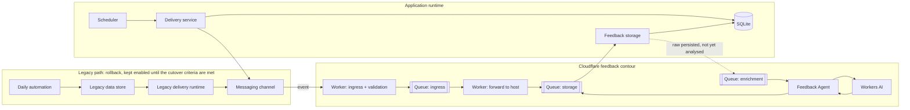
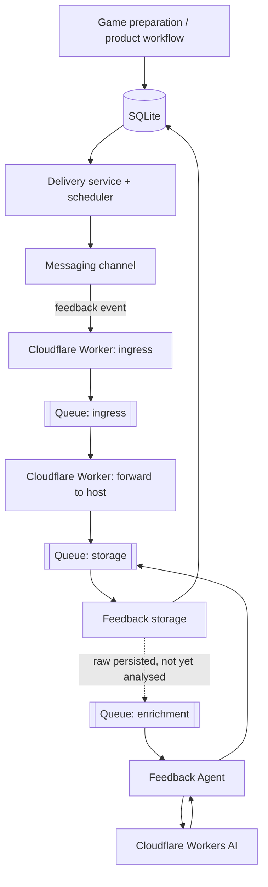

# Architecture — Game of the Day

This document is the architectural source of truth for the project. The README provides the public overview; GitHub Issues track implementation and migration state.

> Delivery and feedback persistence run entirely on the VPS/SQLite application runtime; delivery has been production since 2026-09-18. The legacy Google path stays enabled as an unverified rollback until the exit criteria in #32 are met — that is a deliberate hedge, not evidence that either boundary is still mid-move.

## 1. Architecture overview



Three separate Cloudflare Queues carry feedback, not one: an ingress queue, a storage queue used twice (raw, then analysis — this is the "storage" queue crossing into `APP` above), and an enrichment queue that sends a raw event back out to the Worker for AI classification. The host crosses the Cloudflare boundary twice per feedback event: once to persist the raw event and request enrichment, once to persist the resulting analysis. This round trip is why an ambiguous publish can duplicate enrichment (see [Reliability model](reliability.md)).

Current migration boundary:

```text
delivery: host scheduler → messaging channel        [production since 2026-09-18; legacy path kept as rollback]
feedback: channel → Cloudflare queues → host consumer → SQLite  [cut over]
state:    legacy store → SQLite                    [source of truth in practice; legacy retirement gated on #32]
ingress:  none for feedback (queue pull/push only)   [HTTP API removed]
```

Concrete production hostnames, origin addresses, recipient identities, and internal ports are intentionally excluded from the public repository. Two known exceptions are tracked, not hidden: the ops unit files (`ops/backup`, `ops/bot`, `ops/day-outcome`, `ops/delivery`) name the actual host service user and its `/srv/...` path, and two legacy-path identifiers (a messaging group id, a spreadsheet id) are still hardcoded in source. Both are pre-publication work, not committed by oversight (#34).

## 2. Application runtime

The application host contains the durable production runtime.

Verified capabilities include:

- historical activity, delivery, and feedback data imported into SQLite;
- database integrity checks;
- a queue consumer on the host that persists raw feedback and its analysis through an idempotent storage module (unique by channel and event id);
- isolated regression tests for create, duplicate/retry, conflict, concurrent writers, analysis persistence, and the consumer's acknowledge-only-after-persist rule;
- a delivery state machine run by a host timer: idempotent sends (same idempotency identity on retry), explicit retry of failed deliveries, a machine-readable state for tooling, and an owner-only chat control for manual send/retry;
- daily preparation on the host with deterministic validation of every candidate (the model proposes, code enforces safety and format);
- a nightly online backup of the database with an integrity check, a freshness check and failure alerts.

SQLite is not directly exposed to the network.

## 3. Ingress

Feedback reaches the host only through Cloudflare Queues: the Worker publishes, and the host consumer pulls and pushes over the queue API. There is no inbound application route.

The HTTP Feedback API that existed during the migration was removed after a traffic check found no callers (three rejected requests during cutover testing, none since). A future channel that needs inbound HTTP defines its own adapter and route; adapters normalise input into the same feedback envelope and do not define the domain model. A tunnel connector, where present, is transport infrastructure and not an application router.

The repository does not publish environment-specific tunnel identifiers or origin details.

## 4. Target production architecture



| Component | Responsibility |
|---|---|
| SQLite | durable product state, activities, delivery state, feedback, analysis |
| Delivery service | select the current activity, own delivery state transitions, perform channel send |
| Scheduler | trigger safe delivery attempts |
| Cloudflare Tunnel | optional secure origin transport; no application route behind it at present |
| Messaging channel | user-facing delivery and feedback transport |
| Cloudflare Worker | callback ingress, validation, environment routing, queue producer/consumer |
| Cloudflare Queues | three durable boundaries for feedback: ingress, storage (used for both raw and analysis), enrichment |
| Workers AI | semantic feedback classification |
| Feedback storage | idempotent persistence boundary, called in-process by the queue consumer |
| Monitoring agent | runtime health collection, diagnosis, and alerting |
| Legacy runtime | rollback-only after cutover, then retirement |

## 5. Migration strategy

The migration is intentionally decomposed into independently verifiable boundaries:

```text
production-safe delivery state machine
        ↓
reproducible scheduler

Feedback storage + persistence contract
        ↓
Cloudflare downstream switch
        ↓
real feedback acceptance

all migration gates + observability
        ↓
final source-of-truth / scheduler cutover
        ↓
stability period
        ↓
legacy runtime retirement
```

The final cutover is the only point at which the new scheduler becomes the sole production delivery owner. Structural refactoring is postponed until migration stability is established.

## 6. Delivery invariants

- only the activity for the intended local date is eligible for scheduled delivery;
- an empty message is never sent;
- a confirmed `sent` delivery is not sent again;
- external side effects have stable idempotency identities;
- delivery states are explicit: `pending`, `sending`, `sent`, `failed`;
- `failed` deliveries are recoverable through an explicit retry that reuses the same idempotency identity, and the retry refuses any other state;
- a stale `sending` state is not automatically recovered yet: it needs manual recovery (tracked work);
- `sent_at` is recorded only after confirmed success;
- absence of an activity for the current date is a valid no-op, not data corruption;
- repeated scheduler executions must not create uncontrolled duplicate delivery.

## 7. Feedback invariants

```text
channel callback
→ validate
→ durable queue
→ persist raw feedback
→ semantic processing
→ persist validated analysis
```

- raw feedback becomes durable before AI processing;
- an external event identity is used for idempotency;
- duplicate events do not create duplicate feedback records;
- retries resolve the existing event/record rather than retargeting a newer activity;
- analysis is linked to the same durable feedback record;
- AI failure leaves feedback recoverable as received/unprocessed;
- queue retries are bounded;
- test and production environments remain isolated;
- storage migration must not silently change the semantic feedback contract.

## 8. Deterministic / AI boundary

### Deterministic application code

Owns:

- security and routing validation;
- dates and delivery windows;
- idempotency, retry, and recovery;
- workflow state;
- persistence and record linking;
- segmentation and provenance;
- schema and business validation;
- policy decisions;
- external side effects.

### AI / LLM

May perform:

- semantic classification of free-form feedback;
- interpretation of ambiguous reactions;
- constrained semantic target resolution;
- future recommendation steps where deterministic ranking is insufficient.

The LLM is not the application's memory, workflow engine, or source of truth.

## 9. Feedback Agent contract

```text
feedback text
→ deterministic segmentation + provenance
→ AI classification of existing segments
→ deterministic validation
→ deterministic policy
→ guarded target linking
```

Key invariants:

- the model does not create evidence spans;
- metadata is context, not user evidence;
- unresolved targets remain `UNSPECIFIED` rather than guessed;
- semantic extraction does not directly create durable preferences;
- clarification and product decisions belong to the application layer.

The current production model is `@cf/google/gemma-4-26b-a4b-it`.

## 10. Multi-user and multi-channel boundary

The current MVP does not require a full multi-tenant rewrite, but new code should avoid introducing irreversible single-user or single-channel assumptions.

```text
context = {
  tenantId,
  childId,
  recipientId,
  connectionId,
  channel,
  environment
}
```

The channel is transport, not product identity. Child-specific state belongs to the child/product context and should remain reusable across delivery channels.

## 11. Observability

The project favors lightweight, explicit operational observability over a large monitoring stack at its current scale.

The intended chain is:

```text
application events
→ structured service logs
→ deterministic health checks
→ monitoring agent
→ diagnosis on state change
→ alert / recovery notification
```

The intended health checks cover database integrity, abnormal delivery states, scheduler/service health, feedback persistence state, and expected delivery freshness. Healthy polling should remain inexpensive and should not require an LLM call.

Implemented today: failure alerts to the owner from preparation, delivery and failed systemd units (Telegram, in Russian); the nightly backup with its own freshness check; a bounded-liveness rule for the manual-control bot; an independent daily-outcome check (`ops/day-outcome`) that reads today's delivery state on its own, several times after the delivery window, and alerts if the outcome was not met — this is what process alerts alone missed on 2026-09-20/21 (two days unnoticed). **Not implemented yet:** an external heartbeat that would notice the whole host being down, which none of the above can see (#50).

Logs must not contain credentials, secret headers, infrastructure secrets, or unnecessary raw user feedback.

## 12. Security boundaries

- secrets are never committed to Git;
- runtime credentials remain outside the repository;
- callback and API authentication material is runtime configuration;
- ingress callbacks are validated before business processing;
- persistence endpoints require authentication;
- the application API is isolated behind the ingress layer;
- only required public paths are exposed;
- test and production state are isolated;
- SQLite is never directly exposed;
- production infrastructure identifiers should not be part of the repository; the service-user name and its deployment path in the `ops/*` unit files, and two legacy identifiers in source, are a known, tracked exception (#34), not yet fixed;
- monitoring uses a diagnostic boundary separate from application ownership where practical.

See [`../SECURITY.md`](../SECURITY.md) for repository security policy.

## 13. Failure model and rollback

Migration steps are designed so failure does not require destructive rollback.

Before final cutover, the legacy delivery runtime remains available. During cutover it is disabled rather than immediately deleted. Data and code are retained for a stability window.

The feedback persistence cutover is complete. The previous persistence path and the intermediate HTTP API no longer exist (the API had no callers and was removed); rolling back feedback means reverting the change and redeploying, with the queues as the durable buffer in between.

The delivery rollback path is the legacy runtime, kept enabled by decision until measurable exit criteria are met (tracked in #32). Whether the legacy sender still delivers has not been verified, so it must not be relied on as a safety net without a drill.

Physical removal of legacy runtime code happens only after stable production operation on the new contour.

## 14. Cost boundary

The project currently follows a strict no-unplanned-spend policy. Free-tier services and quotas are acceptable; automatic paid escalation is not.

Quota exhaustion or model unavailability must degrade into a recoverable application state rather than silently enabling paid consumption or breaking daily delivery.
