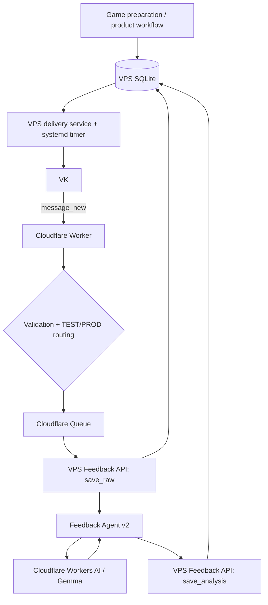

# Архитектура «Игра дня»

Этот документ — source of truth по архитектуре проекта. README содержит обзор, GitHub Issues — backlog и execution state.

> Целевая архитектура не считается production, пока migration EPIC #27 и cutover #32 не закрыты.

## 1. Текущее production-состояние

### Delivery

```text
Daily automation
→ Google Sheets
→ Google Apps Script
→ VK
```

Этот путь остаётся production до контролируемого cutover. Завтрашние/текущие отправки не переключаются на VPS автоматически до завершения migration tests.

### Feedback

```text
VK message_new
→ Cloudflare Worker
→ validation + TEST/PROD routing
→ Cloudflare Queue
→ Apps Script Feedback API: save_raw
→ Google Sheets
→ Feedback Agent v2
→ Cloudflare Workers AI / Gemma
→ Apps Script Feedback API: save_analysis
→ Google Sheets
```

Cloudflare Queue остаётся durable boundary. Raw feedback сохраняется до AI. Принцип `AI failure != product failure` сохраняется.

## 2. Уже подготовленный VPS-контур

На VPS развёрнут `/srv/game-of-the-day` и создан SQLite `data/game-of-the-day.db`.

Текущее состояние migration contour:

- исторические игры/доставки/feedback импортированы из Google;
- SQLite quick_check проходит;
- delivery CLI существует (`status`, `send-last`);
- VK credentials вынесены из Git в runtime config;
- CLI пока не является production scheduler;
- `send-last` не используется как production command;
- обнаруженный риск stale `sending` должен быть закрыт в #28;
- VPS Agent наблюдает host/runtime и SQLite health.

SQLite уже является подготовленным новым storage contour, но **ещё не production source of truth**.

## 3. Активная архитектурная миграция — #27

Цель: полностью убрать Google Sheets и Google Apps Script из production runtime, сохранив Cloudflare.

### Целевая production-схема



Ответственность после cutover:

| Компонент | Ответственность |
|---|---|
| VPS / SQLite | durable product state, games, delivery state, feedback, analysis |
| VPS delivery service | выбор сегодняшней игры, delivery state machine, VK send |
| systemd timer | scheduling/retry attempts |
| VK | пользовательский delivery/feedback channel |
| Cloudflare Worker | ingress, validation, routing, Queue producer/consumer |
| Cloudflare Queue | durable feedback processing boundary |
| Workers AI / Gemma | semantic feedback classification |
| VPS Feedback API | authenticated persistence boundary для Cloudflare |
| VPS Agent | infrastructure/runtime monitoring and diagnostics |
| Google | legacy/rollback only после cutover, затем removal |

## 4. Migration tasks и порядок

Активный EPIC: #27.

```text
#28 VPS delivery: send-today + recovery + idempotency
        ↓
#29 VPS delivery scheduler / systemd

#30 VPS Feedback API
        ↓
#31 Cloudflare → VPS feedback persistence

#28 + #29 + #30 + #31
        ↓
#32 production cutover / disable Google runtime
        ↓
stability period
        ↓
archive/remove legacy Google code
```

#28 и #30 могут выполняться параллельно. #32 — единственная точка production cutover.

## 5. Delivery invariants после миграции

- выбирается только игра за текущую дату в Europe/Moscow;
- пустой message не отправляется;
- sent delivery повторно не отправляется;
- side effect имеет стабильную idempotency identity;
- состояния `pending / sending / sent / failed` явные;
- stale `sending` recoverable;
- retryable `failed` recoverable;
- `sent_at` фиксируется только после подтверждённого success;
- отсутствие сегодняшней игры — штатное состояние, а не corruption;
- scheduler не должен создавать duplicate delivery.

## 6. Feedback invariants после миграции

```text
VK callback
→ validate
→ Queue
→ VPS save_raw
→ AI
→ VPS save_analysis
```

- raw feedback durable до AI;
- callback/event id — idempotency identity;
- duplicate event не создаёт второй feedback;
- analysis связывается с тем же feedback record;
- AI failure оставляет feedback received/unprocessed;
- Queue retries остаются bounded;
- TEST/PROD isolation сохраняется;
- semantic contract Feedback Agent v2 не меняется в рамках storage migration.

## 7. Граница deterministic / AI

### Deterministic code

- routing/security validation;
- даты/delivery window;
- idempotency/retry/recovery;
- workflow state;
- persistence/linking;
- segmentation/provenance;
- schema/business validation;
- policy/decision;
- внешние side effects.

### AI / LLM

- semantic classification свободного feedback;
- ambiguity/reaction interpretation;
- semantic target resolution внутри разрешённого candidate space;
- будущая персонализация/selection только там, где rules недостаточны.

LLM не является памятью, workflow engine или source of truth.

## 8. Feedback Agent v2

```text
feedback.text
→ deterministic segmentation + provenance
→ AI classification of existing segments
→ deterministic validation
→ deterministic policy
→ guarded target linking where applicable
```

Инварианты:

- LLM не создаёт evidence spans;
- metadata — context, не evidence;
- неподтверждённый target остаётся `UNSPECIFIED`;
- extraction не создаёт durable preference;
- clarification/product decisions принадлежат application layer.

Production model: `@cf/google/gemma-4-26b-a4b-it`.

## 9. Multi-user / multi-channel boundary

#20 остаётся cross-cutting constraint, но не блокирует #27.

```text
context = {
  tenantId,
  childId,
  recipientId,
  connectionId,
  channel,
  environment
}
```

Channel — transport, не product identity. Новая SQLite/domain model не должна закреплять новые VK-only/single-user assumptions, но migration не должна разрастаться в преждевременный multi-tenant rewrite.

## 10. Текущий engineering route

#26 architecture simplification приостановлен до завершения #27, потому что нельзя одновременно делать behavior-preserving refactor и менять storage/runtime boundary.

Актуальный маршрут:

```text
#27 Google → VPS/SQLite migration
  ├─ #28 delivery state machine
  ├─ #29 scheduler
  ├─ #30 Feedback API
  ├─ #31 Cloudflare switch
  └─ #32 cutover
        ↓
#26 architecture simplification
        ↓
#14 request feedback UX
→ #7 clarification workflow
→ #8 personalization
```

Параллельно: #9 AI quota/recovery/graceful degradation.

Следующий product layer: #22 selectable development focus → #23 child development track → #24 goals/progress. Telegram #21 остаётся отдельным пользовательским channel expansion.

## 11. Zero-cost policy

Hard requirement: **0 ₽ без отдельного явного решения пользователя**.

Cloudflare Workers, Queues и Workers AI используются только в бесплатном контуре. Migration на VPS не должна добавлять OpenAI API или иной автоматический платный provider. Исчерпание free quota приводит к controlled failure/pending state, а не paid overage.

## 12. Security boundaries

- secrets не хранятся в Git;
- VPS credentials/runtime secrets находятся вне repository;
- Cloudflare callback/shared secrets — runtime secrets;
- Worker валидирует callback до business processing;
- VPS Feedback API обязан аутентифицировать Cloudflare requests;
- TEST/PROD изолированы;
- operational logs не содержат secrets/полный feedback без необходимости;
- SQLite не публикуется наружу напрямую;
- внешний доступ идёт через узкий API boundary;
- VPS Agent имеет отдельную read-only diagnostic identity и не является application runtime identity.

## 13. Rollback policy

До #32 Google остаётся текущим production path. Во время cutover старый Google runtime не удаляется: triggers/endpoints отключаются, но код и данные сохраняются на период проверки. Physical removal/archive выполняется только после стабильной работы VPS contour.