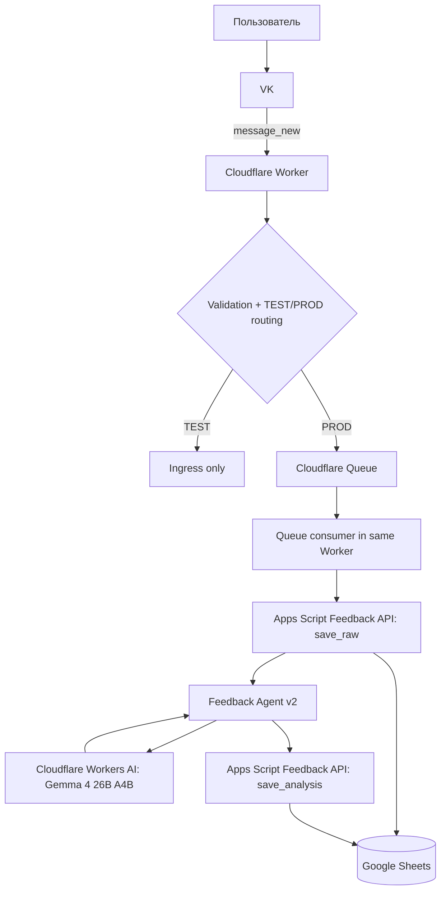

# Архитектура «Игра дня»

Этот документ — source of truth по архитектуре проекта. README содержит обзор, GitHub Issues — конкретный backlog.

> Блоки в разделе «Целевое направление» не считаются реализованными, пока соответствующая задача не закрыта.

## 1. Текущее production-состояние

### 1.1 Delivery

```text
Daily automation
→ Google Sheets
→ Google Apps Script
→ VK
```

Работает end-to-end. Apps Script проверяет сегодняшнюю игру, отправляет её в окне доставки, повторяет попытку при необходимости и после успеха отмечает `J = Да`.

### 1.2 Feedback

С 13.09.2026 production feedback больше не выполняет долгий AI-анализ внутри HTTP `waitUntil()`. Для durable execution используется Cloudflare Queue.



HTTP callback отвечает VK после успешной публикации сообщения в Queue. AI-инференс и сохранение анализа происходят уже в Queue consumer.

### Ответственность компонентов

| Компонент | Ответственность | Статус |
|---|---|---|
| Daily automation | Поиск, проверка истории, выбор и запись игры | Работает |
| Google Sheets | Журнал игр, delivery state, raw ОС, analysis | Работает |
| Apps Script delivery | Delivery window, retry, VK send, sent-state | Работает |
| Apps Script Feedback API | idempotency, linking, `save_raw`, `save_analysis` | Работает |
| VK | Канал доставки и feedback | Работает |
| Cloudflare Worker | Ingress, validation, TEST/PROD routing, Queue producer/consumer | Работает |
| Cloudflare Queue | Durable boundary для медленного feedback processing | Работает |
| Workers AI | Бесплатный LLM runtime | Работает |
| Feedback Agent v2 | Семантический анализ ОС с deterministic provenance/validation | Работает в PROD |

## 2. Feedback Agent v2

Текущая архитектура:

```text
feedback.text
→ deterministic segmentation + provenance
→ AI classification of existing segments
→ deterministic schema/business validation
→ deterministic policy
→ guarded target linking where applicable
```

Ключевые инварианты:

- LLM не создаёт evidence spans;
- evidence всегда восходит к исходному `feedback.text`;
- metadata игры может быть context, но не evidence;
- target linking работает только по разрешённому candidate space;
- если target не доказан, результат остаётся `UNSPECIFIED`;
- extraction layer не создаёт durable preference;
- product decision и clarification policy принадлежат deterministic application code.

Production regression case `Ребёнку понравилось, несколько раз сам повторял действие` успешно обработан Gemma: первая часть классифицирована как explicit positive evaluation, вторая — как voluntary engagement, оба target остались `UNSPECIFIED`, decision — `OBSERVATION_RECORDED`.

## 3. Надёжность feedback flow

Ключевой принцип:

> **AI failure != product failure**

Текущий путь:

```text
VK callback
→ validate
→ Queue.send({eventId, feedbackText})
→ 200 OK
→ Queue consumer
→ save_raw
→ AI
→ save_analysis
```

Свойства:

- callback event/message id используется как idempotency key;
- `save_raw` выполняется до AI;
- повтор полностью обработанного события не вызывает новый inference;
- AI/save_analysis failure пробрасывается в Queue и получает bounded retry;
- `max_batch_size = 1` изолирует один медленный inference;
- `max_retries = 2`, `retry_delay = 60`, `max_concurrency = 1`;
- TEST peer не мутирует PROD Sheet;
- Queue и Workers AI используются только в бесплатном контуре.

Оставшаяся reliability-работа ведётся в #9: quota states, recovery после исчерпания retries, pending reprocessing и UX деградации.

## 4. Граница deterministic / AI

### Deterministic code

- routing и security validation;
- даты и delivery window;
- idempotency и retry policy;
- workflow state;
- linking feedback к игре;
- persistence;
- segmentation/provenance;
- schema/business validation;
- policy/decision;
- safety guardrails, которые можно выразить правилами;
- внешние side effects.

### AI / LLM

- semantic classification свободного feedback;
- ambiguity/reaction interpretation;
- semantic target resolution только внутри заранее разрешённого candidate space;
- будущая персонализация и selection там, где правила недостаточны.

LLM не является памятью, workflow engine или источником истины о state.

## 5. Текущий data/state

Google Sheets остаётся MVP-хранилищем журнала и feedback:

- A ID;
- B дата;
- C возраст;
- D название игры;
- E навык;
- F механика;
- G источник;
- H ссылка;
- I текст для отправки;
- J отправлено;
- K raw feedback;
- L время ОС;
- M structured analysis;
- N ОС обработана.

Apps Script Script Properties используются для event-id → row idempotency mapping.

Миграция на отдельную БД не требуется до появления реальной сложности state/multi-user. Новые контракты должны, однако, не зависеть от Google Sheets как от доменной модели.

## 6. Multi-user / multi-channel boundary

#20 остаётся архитектурным ограничением, а не отдельной большой миграцией.

Целевая context-модель:

```text
context = {
  tenantId,
  childId,
  recipientId,
  connectionId,
  channel,
  environment
}
```

Принципы:

- channel — transport, а не product identity;
- child-specific memory принадлежит `child_id`;
- VK и Telegram должны использовать один product state;
- не добавлять новые global single-user assumptions;
- текущий single-family MVP не переписывать заранее ради гипотетического масштаба.

## 7. Целевое направление

Проект не должен становиться «мультиагентным» ради самой мультиагентности.

Целевая логическая схема:

```text
Events / channels
→ application workflow
→ specialized semantic components only where needed
→ deterministic state / guardrails / side effects
```

Harness / Model Router (#10) вводятся только если после #26 и дальнейшего развития действительно появляется повторяющаяся orchestration/model-routing проблема. До этого текущий Worker + явные функции остаются предпочтительнее дополнительного framework/layer.

Возможные будущие semantic-компоненты:

- Feedback Agent;
- Selection Agent;
- Safety semantic check — только если deterministic rules недостаточны.

## 8. Текущая инженерная задача: #26

После #6 код Feedback Agent стал значительно сложнее относительно масштаба продукта. Поэтому ближайшая архитектурная задача — не добавление новых слоёв, а упрощение существующих.

Цели #26:

- inventory реального runtime path;
- удалить dead code;
- уменьшить over-fragmentation;
- объединить маленькие модули без самостоятельной архитектурной ценности;
- разделять большие файлы только там, где это улучшает понимание;
- сократить file hopping по основному feedback flow;
- сохранить deterministic/AI boundary и текущие eval-контракты;
- не вводить новые framework/abstraction layers.

Текущее дерево Worker содержит отдельные подпапки `detection/` и `segmentation/`, а также несколько последовательных target-* модулей. Это не автоматически ошибка: #26 должен проверить каждый уровень по фактической ответственности и импортам, а не сокращать число файлов ради метрики.

## 9. Product workflow, который архитектура должна поддерживать

Ближайший продуктовый маршрут после #26:

```text
#14 request feedback UX
→ #7 clarification workflow
→ #8 personalization
```

#9 reliability продолжается как сквозная техническая работа и не должна снова разрастаться внутрь semantic задач.

Следующий слой:

```text
#22 selectable development focus
→ #23 child development track
→ #24 goals/progress
```

Telegram (#21) развивается совместно с ограничениями #20 и должен использовать тот же product state.

## 10. Zero-cost policy

Для проекта действует hard requirement: **0 ₽ без отдельного явного решения пользователя**.

Текущий production stack использует бесплатные квоты Cloudflare Workers, Queues и Workers AI. Исчерпание бесплатной квоты должно приводить к controlled failure/pending state, а не к автоматическому платному overage.

## 11. Security boundaries

- secrets не хранятся в Git;
- VK token — Apps Script Script Properties;
- callback/shared secrets — runtime secrets;
- Worker валидирует callback до бизнес-обработки;
- TEST и PROD изолированы;
- peer IDs, secrets и полный текст feedback не должны попадать в обычные operational logs;
- будущие channel credentials остаются в secret store, а product state хранит только стабильные identifiers/references.
