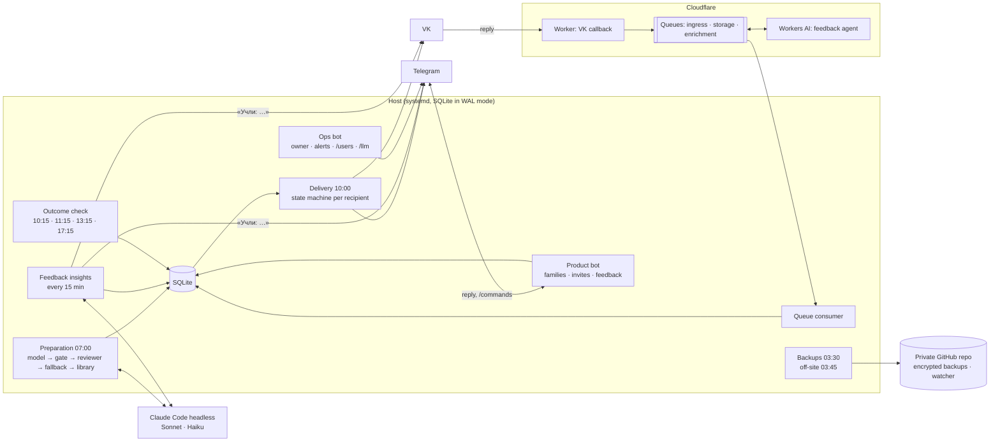

# Architecture — Game of the Day

The system as it runs in production. What can fail and how it is noticed and recovered
is in [reliability.md](reliability.md). How the models are used and kept in bounds is in
[ai-design.md](ai-design.md). Installing it is covered in [deployment.md](deployment.md).

## 1. Overview



Two Telegram bots on purpose: the **product bot** faces families and runs as its own
unprivileged user; the **ops bot** belongs to the owner and carries alerts and manual
controls. They share nothing but the database.

## 2. Components

| component | code | runs | does |
|---|---|---|---|
| Preparation | `src/preparation` | 07:00, retries 08:00 and 09:00 MSK | one game per active child: prompt with age-banded skills and the child's profile → model → deterministic gate → corrective retries → fallback model → library |
| Delivery | `src/delivery` | 10:00, catch-up 10:12 | one delivery per recipient (VK or Telegram); idempotent; recovers an interrupted send from the messenger history; adds the child's name for a shared chat, birthday greetings and the invitation to reply |
| Outcome check | `src/ops/day_outcome_check.py` | 10:15, 11:15, 13:15, 17:15 | independently verifies that every delivery of the day is `sent` |
| Feedback ingress (VK) | `worker/` + `src/feedback/queue_consumer.py` | always | Worker validates the callback and queues the event; the host stores the raw text before any model call; stickers and photos become labels |
| VK dialog | `src/bot/vk_dialog.py` + `src/feedback/vk_inbound.py` | always (in the consumer) | every private VK message arrives with the sender's peer id: a subscribed family's text is a command or feedback on its own games; anyone else gets the questionnaire, which ends in an application the owner approves in the ops bot; replies and the outbox are sent once (inbound events, VK `random_id`) |
| Feedback ingress (Telegram) | `src/bot/product_bot.py` | always | stores the text with an explicit game id (reply-to message or the chat's latest game) |
| Feedback insights | `src/feedback/insights.py` | every 15 minutes | merges messages sent together, extracts observations with verbatim quotes, rebuilds the child's profile, separates wishes about the service, replies once |
| Product bot | `src/bot` | always | invite-only onboarding, FAQ, `/children`, `/add_child`, `/pause`, `/resume`, `/idea` |
| Ops bot | `src/ops/manual_bot.py` | always | `/status`, `/send`, `/retry` with one-time codes; `/users`, `/llm`, `/ideas`; forwards product events |
| Reports | `src/ops/llm_report.py`, `users_report.py` | Mondays 10:30; on demand | model quality, latency, tokens, cost, reserve days; families; wishes |
| Parents' digest | `src/ops/weekly_digest.py` | Sundays 19:00 | the week's games and skills, what went well, one or two home ideas for next week (no age norms), a monthly question; optionally (off unless `GAME_DIGEST_STAR_REQUEST=1`) a one-time request to star the project on GitHub |
| Warm reserve | `src/preparation/fallback.py` | Sundays 04:30 | keeps at least three validated games for each child's next two months |
| Backups | `ops/backup` | 03:30 local, 03:45 off-site, Sundays restore test | SQLite online backup → age-encrypted copy in a private repository → weekly restore into a sandbox |
| Deploy | `ops/deploy.sh` | by hand | backup → fast-forward → tests → migrate → units → restart → health |

## 3. Data model

Product state belongs to a **child**, not to a messenger dialog.

```text
children ──< recipients (channel, address, active)
   │
   ├──< games (date, age, skill, origin: model | fallback_model | library, candidate_json)
   │       └──< deliveries (channel, recipient, status, idempotency_key, external_message_id)
   │       └──< feedback (raw text, channel event id, insights status)
   │                └──< observations (kind, value, skill, verbatim evidence)
   ├── child_profiles (built by code from observations)
   └── (is_test: gets games only from a manual run)

members ── invites (hash only) · onboarding (questionnaire state)
reserve_games · model_runs · user_events · wishes · digests · star_requests
```

All migrations are additive (`src/db/children.py migrate`, schema version 11): the
previous code keeps working on a migrated database, which is what makes a code rollback
safe. A database with no children runs in the original single-child mode from the
environment.

## 4. A day

```text
03:30  local backup (integrity check, retention)      03:45  encrypted off-site copy
07:00  preparation for every active child (08:00, 09:00 retry only what is missing)
10:00  delivery to every recipient                    10:12  catch-up and reconciliation
10:15  outcome check (again 11:15, 13:15, 17:15)
*/15   feedback insights                              */5    host health (infra repository)
Mon    LLM report                                     Sun    reserve top-up, restore test, parents' digest 19:00
```

## 5. Delivery invariants

- only the activity for the intended local date is eligible for scheduled delivery;
- an empty message is never sent;
- a confirmed `sent` delivery is not sent again;
- external side effects have stable idempotency identities (VK `random_id` is derived
  from the delivery's idempotency key);
- delivery states are explicit: `pending`, `sending`, `sent`, `failed`;
- `failed` is recovered only by an explicit retry that reuses the same identity;
- a stale `sending` is reconciled against the messenger history: delivered → `sent`, not
  delivered → `failed` awaiting an explicit retry; Telegram, which cannot be queried, is
  reported, not guessed;
- each recipient has its own delivery, so one channel failing does not block another;
- `sent_at` is recorded only after confirmed success;
- repeated scheduler runs never create a second delivery.

## 6. Feedback invariants

```text
channel event → validate → durable queue (VK) / direct (Telegram)
→ persist raw feedback → insights (observations, profile, wish) → one reply
                       ↘ semantic feedback agent (VK, Workers AI)
```

- raw feedback is durable before any model call; a model failure leaves it pending;
- an external event identity makes ingestion idempotent;
- a retry resolves the existing record, never a newer activity;
- feedback attaches to an explicit game when the channel allows it (Telegram reply,
  chat-scoped lookup); a test child's games never absorb unattributed feedback;
- an observation is kept only if its quote is verbatim in the feedback;
- wishes about the service never enter the child's profile;
- stickers, photos and voice messages are labels, never stored media.

## 7. Deterministic / AI boundary

Deterministic code owns: authentication and routing, invitations, dates and windows,
workflow state, idempotency, retries and recovery, persistence and record linking, the
skills offered at each age, the safety gate, the fallback chain and the library choice,
the child's profile, budgets and caps, and every external side effect.

Models are used for exactly three things, each behind a schema and a deterministic check:

1. proposing the day's activity (Claude Sonnet; Haiku as fallback), and reviewing its
   safety after the gate (Haiku);
2. extracting observations and wishes from feedback (Claude Haiku);
3. classifying VK feedback in the semantic feedback agent (Gemma on Workers AI).

A fourth, offline use is the evals judge (Opus), which never touches production state.
The model is never the application's memory, workflow engine or source of truth.

## 8. Families and channels

- a child has any number of recipients; a recipient is a channel plus an address;
- channels today: VK (a community dialog) and Telegram (the product bot);
- a chat with several children gets each game headed with the child's name; feedback in
  such a chat must reply to the game it is about;
- families join only through one-time invites; limits cap children per chat, active
  children in total and feedback per day;
- the owner's VK dialog is a test recipient, used only for manual runs.

## 9. Security boundaries

- secrets live in root-owned `0600` files read by systemd, never in the repository;
- the application runs as `gotd`; the public product bot runs as `gotd-bot` with
  `ProtectProc=invisible`, so it cannot read other services' environment, and shares only
  the database through a group;
- the repository key for off-site backups is used only by root units;
- the ops bot never holds messaging credentials: it starts two fixed units through a
  polkit rule;
- the Worker validates the VK callback secret and community id before anything else;
  the community id is deployment configuration;
- no inbound port on the host: both bots use outbound long polling;
- the child's name and birth date never reach a model, only the age in months;
- invites are stored as hashes; strangers get one notice a day and nothing is stored.

See [`../SECURITY.md`](../SECURITY.md).

## 10. Cost boundary

The service runs on an existing Claude subscription and the free Cloudflare tier.
Nothing switches on paid overage. Each model use has a ceiling: a daily preparation
budget (then the library), at most a few feedback analyses per child and per day, a
weekly cap on reserve generation. Running out of quota degrades to the library and an
owner alert; it never costs the family a day.

## 11. Change and rollback

Every change ships through `ops/deploy.sh`: database backup, fast-forward only, the
test suite on the new code before the migration (a failure rolls the code back with the
database untouched), additive migration, changed units, service health. Releases are
tagged from [CHANGELOG.md](../CHANGELOG.md). The original Google Sheets + Apps Script
sender is kept in `legacy/` for reference; it is not a live fallback.
