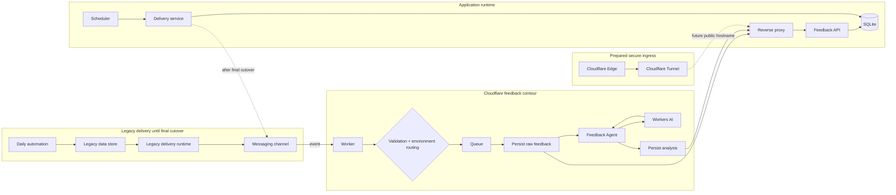
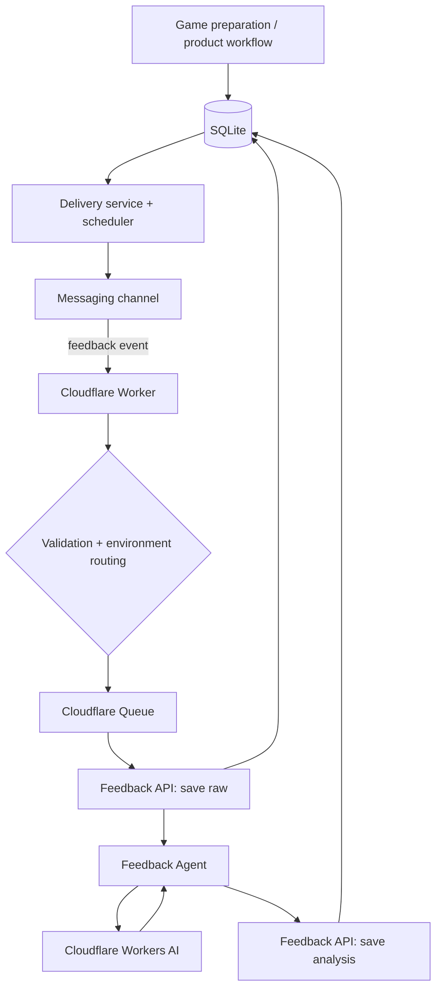

# Architecture — Game of the Day

This document is the architectural source of truth for the project. The README provides the public overview; GitHub Issues track implementation and migration state.

> The system is in a controlled production migration. Delivery and persistence boundaries are being moved independently so each step can be verified and rolled back before the final source-of-truth cutover.

## 1. Architecture overview



Current migration boundary:

```text
delivery: legacy runtime → messaging channel       [production until final cutover]
feedback: channel → Cloudflare → Feedback API      [controlled migration]
state:    legacy store → SQLite                    [becoming source of truth]
ingress:  Cloudflare Tunnel                        [prepared separately]
```

Concrete production hostnames, origin addresses, runtime usernames, filesystem paths, account identifiers, recipient identities, and internal ports are intentionally excluded from the public repository.

## 2. Application runtime

The application host contains the durable runtime being promoted to production ownership.

Verified migration capabilities include:

- historical activity, delivery, and feedback data imported into SQLite;
- database integrity checks;
- authenticated Feedback API running behind a reverse proxy;
- a health endpoint and dedicated raw-feedback / analysis persistence contracts;
- rejection of unauthenticated persistence requests;
- isolated contract tests for create, duplicate/retry, analysis persistence, and processed-state semantics;
- HTTP end-to-end tests against an isolated test database;
- Cloudflare Worker support for the application API contract;
- a delivery CLI/state machine that is being promoted independently from the legacy scheduler.

SQLite is not directly exposed to the network.

## 3. Secure ingress

The target ingress boundary is:

```text
public API hostname
→ Cloudflare Edge
→ Cloudflare Tunnel
→ reverse proxy
→ Feedback API
```

The tunnel connector is treated as transport infrastructure, not as the application router or persistence layer. Direct origin exposure can be removed only after the tunnel route has been verified in production.

The repository does not publish environment-specific tunnel identifiers or origin details.

## 4. Target production architecture



| Component | Responsibility |
|---|---|
| SQLite | durable product state, activities, delivery state, feedback, analysis |
| Delivery service | select the current activity, own delivery state transitions, perform channel send |
| Scheduler | trigger safe delivery attempts |
| Reverse proxy | constrained HTTP ingress to the application API |
| Cloudflare Tunnel | secure origin transport when public routing is enabled |
| Messaging channel | user-facing delivery and feedback transport |
| Cloudflare Worker | callback ingress, validation, environment routing, queue producer/consumer |
| Cloudflare Queue | durable boundary for feedback processing |
| Workers AI | semantic feedback classification |
| Feedback API | authenticated persistence boundary |
| Monitoring agent | runtime health collection, diagnosis, and alerting |
| Legacy runtime | rollback-only after cutover, then retirement |

## 5. Migration strategy

The migration is intentionally decomposed into independently verifiable boundaries:

```text
production-safe delivery state machine
        ↓
reproducible scheduler

Feedback API + persistence contract
        ↓
Cloudflare downstream switch
        ↓
real feedback acceptance

all migration gates + observability
        ↓
final source-of-truth / scheduler cutover
        ↓
stability period
        ↓
legacy runtime retirement
```

The final cutover is the only point at which the new scheduler becomes the sole production delivery owner. Structural refactoring is postponed until migration stability is established.

## 6. Delivery invariants

- only the activity for the intended local date is eligible for scheduled delivery;
- an empty message is never sent;
- a confirmed `sent` delivery is not sent again;
- external side effects have stable idempotency identities;
- delivery states are explicit: `pending`, `sending`, `sent`, `failed`;
- stale `sending` states are recoverable;
- retryable failures are recoverable;
- `sent_at` is recorded only after confirmed success;
- absence of an activity for the current date is a valid no-op, not data corruption;
- repeated scheduler executions must not create uncontrolled duplicate delivery.

## 7. Feedback invariants

```text
channel callback
→ validate
→ durable queue
→ persist raw feedback
→ semantic processing
→ persist validated analysis
```

- raw feedback becomes durable before AI processing;
- an external event identity is used for idempotency;
- duplicate events do not create duplicate feedback records;
- retries resolve the existing event/record rather than retargeting a newer activity;
- analysis is linked to the same durable feedback record;
- AI failure leaves feedback recoverable as received/unprocessed;
- queue retries are bounded;
- test and production environments remain isolated;
- storage migration must not silently change the semantic feedback contract.

## 8. Deterministic / AI boundary

### Deterministic application code

Owns:

- security and routing validation;
- dates and delivery windows;
- idempotency, retry, and recovery;
- workflow state;
- persistence and record linking;
- segmentation and provenance;
- schema and business validation;
- policy decisions;
- external side effects.

### AI / LLM

May perform:

- semantic classification of free-form feedback;
- interpretation of ambiguous reactions;
- constrained semantic target resolution;
- future recommendation steps where deterministic ranking is insufficient.

The LLM is not the application's memory, workflow engine, or source of truth.

## 9. Feedback Agent contract

```text
feedback text
→ deterministic segmentation + provenance
→ AI classification of existing segments
→ deterministic validation
→ deterministic policy
→ guarded target linking
```

Key invariants:

- the model does not create evidence spans;
- metadata is context, not user evidence;
- unresolved targets remain `UNSPECIFIED` rather than guessed;
- semantic extraction does not directly create durable preferences;
- clarification and product decisions belong to the application layer.

The current production model is `@cf/google/gemma-4-26b-a4b-it`.

## 10. Multi-user and multi-channel boundary

The current MVP does not require a full multi-tenant rewrite, but new code should avoid introducing irreversible single-user or single-channel assumptions.

```text
context = {
  tenantId,
  childId,
  recipientId,
  connectionId,
  channel,
  environment
}
```

The channel is transport, not product identity. Child-specific state belongs to the child/product context and should remain reusable across delivery channels.

## 11. Observability

The project favors lightweight, explicit operational observability over a large monitoring stack at its current scale.

The intended chain is:

```text
application events
→ structured service logs
→ deterministic health checks
→ monitoring agent
→ diagnosis on state change
→ alert / recovery notification
```

Health checks cover database integrity, abnormal delivery states, scheduler/service health, feedback persistence state, and expected delivery freshness. Healthy polling should remain inexpensive and should not require an LLM call.

Logs must not contain credentials, secret headers, infrastructure secrets, or unnecessary raw user feedback.

## 12. Security boundaries

- secrets are never committed to Git;
- runtime credentials remain outside the repository;
- callback and API authentication material is runtime configuration;
- ingress callbacks are validated before business processing;
- persistence endpoints require authentication;
- the application API is isolated behind the ingress layer;
- only required public paths are exposed;
- test and production state are isolated;
- SQLite is never directly exposed;
- production infrastructure identifiers are not part of public documentation;
- monitoring uses a diagnostic boundary separate from application ownership where practical.

See [`../SECURITY.md`](../SECURITY.md) for repository security policy.

## 13. Failure model and rollback

Migration steps are designed so failure does not require destructive rollback.

Before final cutover, the legacy delivery runtime remains available. During cutover it is disabled rather than immediately deleted. Data and code are retained for a stability window.

Feedback downstream changes have their own rollback boundary: if real end-to-end persistence fails, routing can return to the previous persistence path while the application API is diagnosed.

Physical removal of legacy runtime code happens only after stable production operation on the new contour.

## 14. Cost boundary

The project currently follows a strict no-unplanned-spend policy. Free-tier services and quotas are acceptable; automatic paid escalation is not.

Quota exhaustion or model unavailability must degrade into a recoverable application state rather than silently enabling paid consumption or breaking daily delivery.
