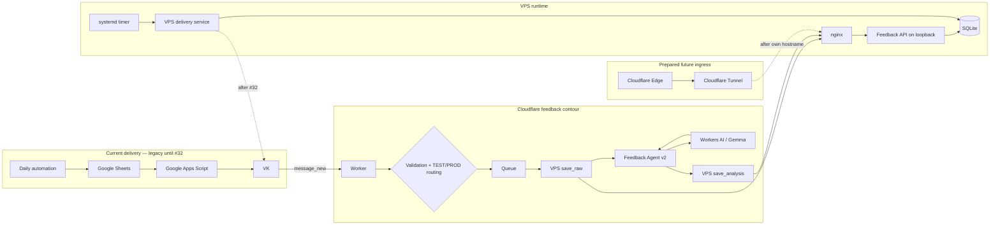
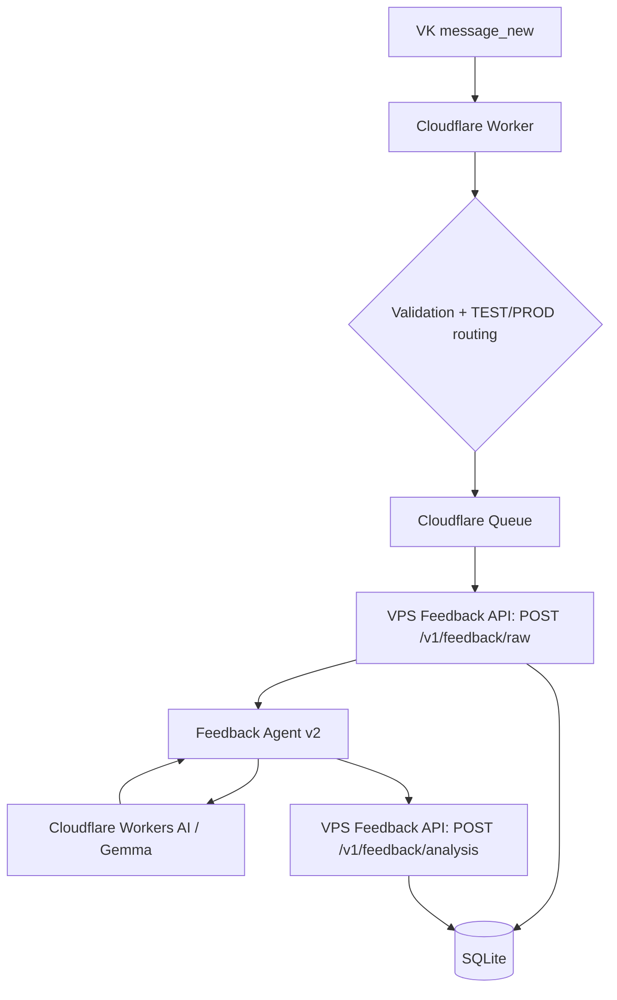
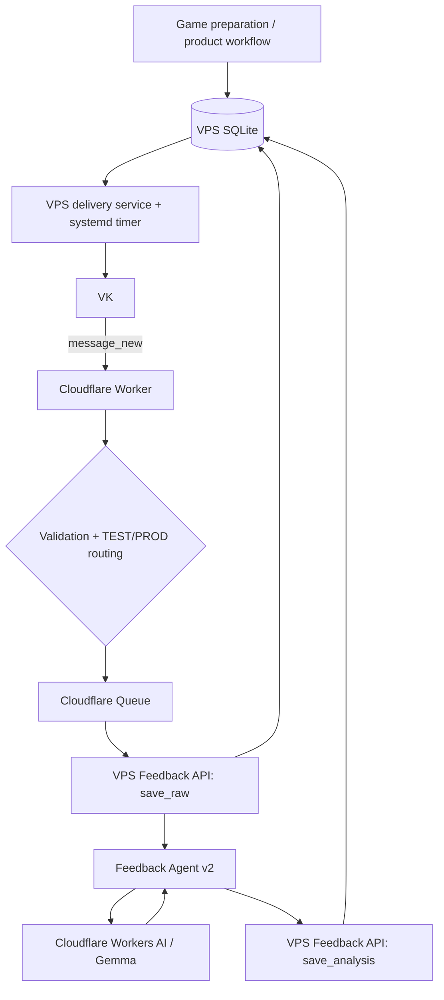

# Архитектура «Игра дня»

Этот документ — source of truth по архитектуре проекта. README содержит обзор, GitHub Issues — backlog и execution state.

> Общий VPS cutover ещё не завершён: delivery остаётся на Google до #32. Feedback-контур находится в контролируемом production cutover #31: Worker подготовлен к VPS API, финальный gate — реальная ОС из VK.

## 0. Architecture overview



Текущая граница миграции:

```text
delivery: Google → Apps Script → VK                  [production до #32]
feedback: VK → Cloudflare → VPS API → SQLite         [cutover #31]
future ingress: Cloudflare Tunnel                     [prepared, not routed]
```

## 1. Текущее production-состояние

### Delivery

```text
Daily automation
→ Google Sheets
→ Google Apps Script
→ VK
```

Этот путь остаётся production до контролируемого cutover #32. VPS delivery не должен параллельно отправлять ту же игру.

### Feedback — текущий cutover #31



Cloudflare Queue остаётся durable boundary. Raw feedback сохраняется до AI. `external_event_id + channel` — idempotency identity. Повтор события после появления более новой игры остаётся связан с исходной игрой. Финальный production acceptance #31 — реальная ОС от PROD-пользователя VK с `processed=1` и `analysis_json` в SQLite.

## 2. VPS runtime

На VPS развёрнут application runtime; SQLite хранится локально вне публичного ingress.

Подтверждено на migration contour:

- исторические games/deliveries/feedback импортированы;
- production DB integrity check проходит;
- Feedback API работает как systemd service на loopback interface;
- API имеет `/health`, authenticated `POST /v1/feedback/raw` и `POST /v1/feedback/analysis`;
- nginx работает как reverse proxy и публикует только необходимые API paths; root возвращает 404;
- запрос к API без bearer auth отклоняется;
- isolated contract tests подтверждают create/retry/save-analysis/processed semantics;
- HTTP E2E через nginx подтверждён на отдельной test DB без мутации production;
- Cloudflare Worker использует новый VPS API contract вместо Apps Script runtime contract;
- delivery CLI существует, но ещё не является единственным production scheduler.

## 3. Public ingress и Cloudflare Tunnel

Текущий рабочий ingress:

```text
Internet
→ temporary VPS provider hostname
→ nginx
→ loopback Feedback API
```

Текущий hostname выдан VPS-провайдером и не находится под DNS-управлением проекта. В публичной документации конкретные hostname/IP/порты origin намеренно не фиксируются.

Параллельно подготовлен Cloudflare Tunnel:

```text
Cloudflare Edge
⇄ project VPS tunnel
⇄ cloudflared connector on VPS
```

Состояние: connector установлен как persistent systemd service, tunnel healthy, QUIC/TCP connectivity pre-checks green. Published public hostname пока намеренно не настроен: собственный домен отложен. Tunnel не является текущим HTTP route и не заменяет nginx.

Будущий ingress после появления собственного домена:

```text
api.<project-domain>
→ Cloudflare Edge
→ Cloudflare Tunnel
→ nginx
→ Feedback API
```

После подтверждённого tunnel cutover прямой публичный ingress на origin можно закрыть. Для будущего второго VPS tunnel/edge layer является подготовленной точкой расширения, но geo-HA не входит в текущий MVP migration.

## 4. Целевая production-схема после #32



Ответственность после cutover:

| Компонент | Ответственность |
|---|---|
| VPS / SQLite | durable product state, games, delivery state, feedback, analysis |
| VPS delivery service | выбор сегодняшней игры, delivery state machine, VK send |
| systemd timer | scheduling/retry attempts |
| nginx | локальный HTTP ingress/reverse proxy к VPS API |
| Cloudflare Tunnel | будущий защищённый origin transport после собственного hostname |
| VK | пользовательский delivery/feedback channel |
| Cloudflare Worker | callback ingress, validation, routing, Queue producer/consumer |
| Cloudflare Queue | durable feedback processing boundary |
| Workers AI / Gemma | semantic feedback classification |
| VPS Feedback API | authenticated persistence boundary для Cloudflare |
| VPS Agent | infrastructure/runtime monitoring and diagnostics |
| Google | legacy/rollback only после cutover, затем removal |

## 5. Migration tasks и фактический порядок

Активный EPIC: #27.

```text
#28 VPS delivery: send-today + recovery + idempotency
        ↓
#29 VPS delivery scheduler / systemd

#30 VPS Feedback API ── implemented + contract/HTTP E2E green
        ↓
#31 Cloudflare → VPS feedback persistence ── production cutover in progress
        ↓
real VK feedback acceptance

#28 + #29 + #30 + #31 + #33
        ↓
#32 production cutover / disable Google runtime
        ↓
stability period
        ↓
archive/remove legacy Google code
```

#32 остаётся единственной точкой общего cutover delivery/source-of-truth. Feedback можно проверить раньше как отдельный controlled cutover #31.

## 6. Delivery invariants после миграции

- выбирается только игра за текущую дату в Europe/Moscow;
- пустой message не отправляется;
- sent delivery повторно не отправляется;
- side effect имеет стабильную idempotency identity;
- состояния `pending / sending / sent / failed` явные;
- stale `sending` recoverable;
- retryable `failed` recoverable;
- `sent_at` фиксируется только после подтверждённого success;
- отсутствие сегодняшней игры — штатное состояние, а не corruption;
- scheduler не должен создавать duplicate delivery.

## 7. Feedback invariants

```text
VK callback
→ validate
→ Queue
→ VPS save_raw
→ AI
→ VPS save_analysis
```

- raw feedback durable до AI;
- callback/event id — idempotency identity;
- duplicate event не создаёт второй feedback;
- retry сначала разрешает существующий event, а не выбирает новую target game;
- analysis связывается с тем же feedback record по event/channel;
- AI failure оставляет feedback received/unprocessed;
- Queue retries остаются bounded;
- TEST/PROD isolation сохраняется;
- semantic contract Feedback Agent v2 не меняется в рамках storage migration.

## 8. Граница deterministic / AI

### Deterministic code

- routing/security validation;
- даты/delivery window;
- idempotency/retry/recovery;
- workflow state;
- persistence/linking;
- segmentation/provenance;
- schema/business validation;
- policy/decision;
- внешние side effects.

### AI / LLM

- semantic classification свободного feedback;
- ambiguity/reaction interpretation;
- semantic target resolution внутри разрешённого candidate space;
- будущая персонализация/selection только там, где rules недостаточны.

LLM не является памятью, workflow engine или source of truth.

## 9. Feedback Agent v2

```text
feedback.text
→ deterministic segmentation + provenance
→ AI classification of existing segments
→ deterministic validation
→ deterministic policy
→ guarded target linking where applicable
```

Инварианты:

- LLM не создаёт evidence spans;
- metadata — context, не evidence;
- неподтверждённый target остаётся `UNSPECIFIED`;
- extraction не создаёт durable preference;
- clarification/product decisions принадлежат application layer.

Production model: `@cf/google/gemma-4-26b-a4b-it`.

## 10. Multi-user / multi-channel boundary

#20 остаётся cross-cutting constraint, но не блокирует #27.

```text
context = {
  tenantId,
  childId,
  recipientId,
  connectionId,
  channel,
  environment
}
```

Channel — transport, не product identity. Новая SQLite/domain model не должна закреплять новые VK-only/single-user assumptions, но migration не должна разрастаться в преждевременный multi-tenant rewrite.

## 11. Engineering route после migration

#26 architecture simplification приостановлен до завершения #27.

```text
#27 Google → VPS/SQLite migration
  ├─ #28 delivery state machine
  ├─ #29 scheduler
  ├─ #30 Feedback API
  ├─ #31 Cloudflare switch
  ├─ #33 observability
  └─ #32 cutover
        ↓
#26 architecture simplification
        ↓
#14 request feedback UX
→ #7 clarification workflow
→ #8 personalization
```

Параллельно: #9 AI quota/recovery/graceful degradation.

Следующий product layer: #22 selectable development focus → #23 child development track → #24 goals/progress. Telegram #21 остаётся отдельным channel expansion.

## 12. Zero-cost policy

Hard requirement: **0 ₽ без отдельного явного решения пользователя**.

Cloudflare Workers, Queues и Workers AI используются только в бесплатном контуре. Собственный домен сейчас не является requirement и не покупается только ради migration. Никакой автоматической платной эскалации при исчерпании free quota.

## 13. Security boundaries

- secrets не хранятся в Git;
- VPS credentials/runtime secrets находятся вне repository;
- Cloudflare callback/shared secrets — runtime secrets;
- Worker валидирует callback до business processing;
- VPS Feedback API аутентифицирует Cloudflare requests Bearer secret;
- Feedback API слушает только loopback; наружу публикуется через nginx;
- nginx публикует только необходимые health/API paths, root = 404;
- TEST/PROD изолированы;
- operational logs не содержат secrets/полный feedback без необходимости;
- SQLite не публикуется наружу напрямую;
- конкретные production hostname, origin IP и внутренние runtime paths/ports не документируются в публичном repository;
- Cloudflare Tunnel подготовлен, но до собственного hostname не считается production ingress;
- VPS Agent имеет отдельную read-only diagnostic identity и не является application runtime identity.

## 14. Rollback policy

До #32 Google delivery остаётся production path. Во время общего cutover старый Google runtime не удаляется: triggers/endpoints отключаются, но код и данные сохраняются на период проверки.

Для #31 rollback — вернуть Worker downstream на Apps Script Feedback API, если реальный VK → VPS feedback acceptance не проходит. Physical removal/archive Google выполняется только после стабильной работы VPS contour.