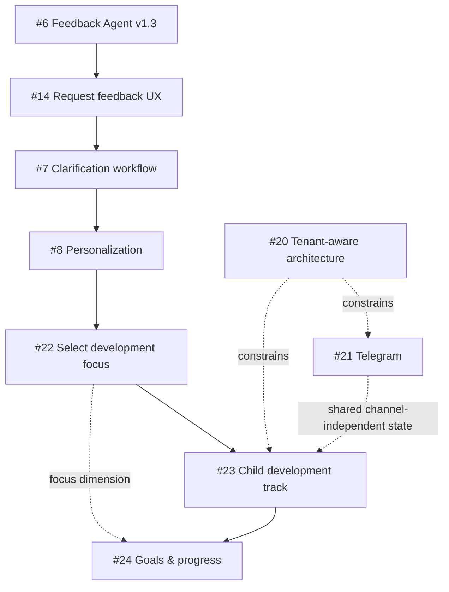

# Product Roadmap — «Игра дня»

Этот документ фиксирует продуктовое направление проекта и связи между крупными инициативами. Техническая архитектура остаётся в [`architecture.md`](architecture.md), а конкретная работа — в GitHub Issues.

## Product vision

Эволюция продукта:

```text
ежедневная полезная игра
→ продукт слушает пользователя
→ персональный подбор
→ трек развития ребёнка
→ история целей и прогресса
```

Целевая ценность:

> Родитель выбирает, что хочет развивать у ребёнка, получает подходящие безопасные занятия, отмечает фактический опыт и со временем видит историю занятий и собственные наблюдения о прогрессе.

Продукт не является медицинским или диагностическим инструментом и не должен делать выводы о норме, задержке или диагнозах.

## V1 — Game of the Day

Статус: работает.

Базовый цикл:

```text
возраст + правила безопасности + история игр
→ выбор новой игры
→ запись в журнал
→ доставка в VK
```

Основные задачи: #1, #2, #3.

## V2 — Feedback loop

Статус: частично production-ready.

Цикл:

```text
игра
→ сыграли / не сыграли
→ оценка / комментарий
→ сохранение raw feedback
→ анализ
→ подтверждённая product memory
```

Ключевые задачи:
- #5 — persistence/linking feedback: done;
- #6 — evidence-bound Feedback Agent v1.3;
- #14 — запрос feedback после игры;
- #7 — clarification workflow.

Принцип: `played / not played` — отдельный факт и не равен оценке игры.

## V3 — Personalization

Цель: следующая игра выбирается не только по возрасту и истории, но и по подтверждённым предпочтениям и текущему фокусу развития.

```text
age
+ safety
+ history
+ confirmed feedback/preferences
+ selected development focus
→ next game
```

Ключевые задачи:
- #8 — personalization from feedback;
- #22 — выбор направления/навыка пользователем;
- #15 — замена уже подготовленной игры по свежей ОС, с отдельными guardrails.

### Навык больше не hard-coded ограничение

Текущие `речь / координация / мелкая моторика` должны стать элементами расширяемой модели, а не единственно допустимым набором.

Доменная иерархия:

```text
направление развития
→ навык
→ цель
→ связанные игры / активности
```

Age и safety остаются обязательными constraints и имеют приоритет над пользовательским выбором.

## V4 — Child Development Track

Цель: хранить долгосрочную историю ребёнка независимо от канала доставки.

```text
child profile
  ├── age / birth date
  ├── selected focus
  ├── goals
  ├── game history
  ├── played / not played
  ├── ratings / feedback
  ├── parent observations
  └── achieved milestones / progress
```

Ключевая задача: #23.

Принципы:
- child data принадлежит `child_id`, а не VK/Telegram peer;
- смена канала не сбрасывает историю;
- смена выбранного направления не удаляет прошлые данные;
- observation родителя хранится как observation, не как медицинский вывод;
- product memory и workflow state должны быть разделены.

## V5 — Goals & Progress

Цель: пользователь задаёт или выбирает конкретную цель и видит объяснимый прогресс по ней.

```text
skill / focus
→ goal
→ activities
→ played/not played + feedback + observations
→ progress
→ achieved / paused / active
```

Ключевая задача: #24.

Прогресс должен объясняться сохранёнными событиями и наблюдениями. LLM не должен самостоятельно объявлять цель достигнутой без подтверждённых данных/правил.

## Multi-channel product

VK — текущий production channel. Telegram — следующий полноценный канал (#21).

Целевая модель:

```text
channel connection (VK | Telegram | ...)
→ recipient
→ tenant/family
→ child profile
→ shared product state
```

Transport не должен определять product logic. История, feedback, preferences, goals и progress должны быть общими для ребёнка независимо от канала.

Связано с #20: multi-user / multi-channel production readiness.

## Product roadmap dependencies



Это не означает жёсткую последовательность реализации каждой задачи. #20 — архитектурное ограничение, которое учитывается инкрементально; #21 может развиваться параллельно после стабилизации критичного feedback route.

## Near-term priority

Текущий P0 route остаётся:

```text
#6 Feedback Agent v1.3
→ #14 feedback request UX
→ #7 clarification
→ #8 personalization
```

После этого продуктовый следующий слой:

```text
#22 selectable skills/focus
→ #23 child track
→ #24 goals/progress
```

Telegram (#21) — P1 channel expansion и должен проектироваться совместно с #20 так, чтобы не создавать второй отдельный product state.
