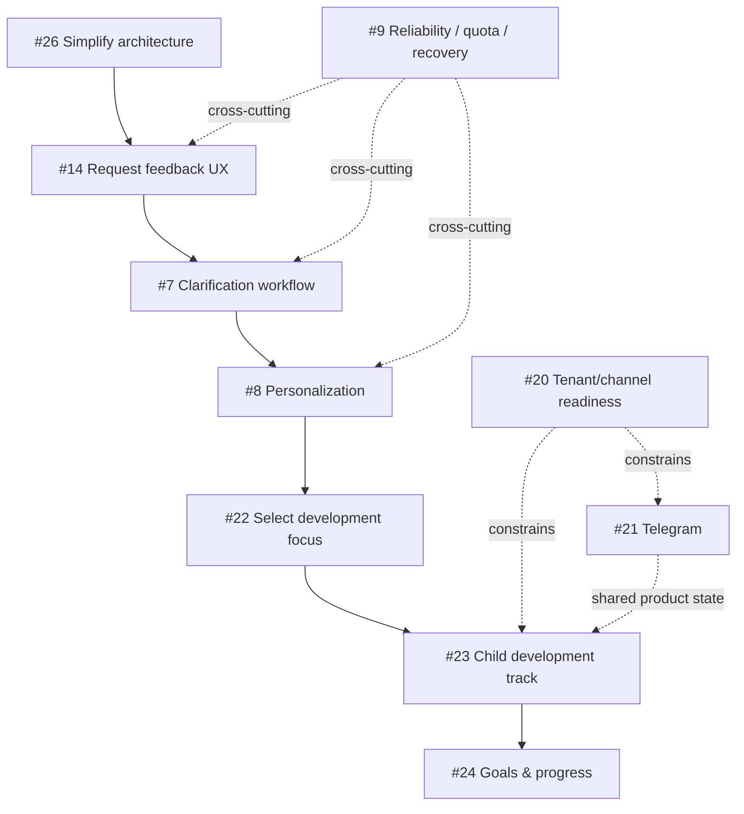

# Product Roadmap — «Игра дня»

Этот документ фиксирует продуктовое направление и зависимости крупных инициатив. Техническая архитектура — в [`architecture.md`](architecture.md), конкретная работа — в GitHub Issues.

## Product vision

```text
ежедневная полезная игра
→ продукт слушает пользователя
→ персональный подбор
→ трек развития ребёнка
→ история целей и прогресса
```

Целевая ценность:

> Родитель выбирает, что хочет развивать у ребёнка, получает подходящие безопасные занятия, отмечает фактический опыт и со временем видит историю занятий и собственные наблюдения о прогрессе.

Продукт не является медицинским или диагностическим инструментом.

## V1 — Game of the Day

Статус: **production-ready**.

```text
возраст + safety + история игр
→ выбор игры
→ Google Sheets
→ Apps Script
→ VK
```

Ключевые задачи #1–#4 закрыты.

## V2 — Feedback loop

Статус: **semantic loop работает в production; UX ещё не завершён**.

Реализованный технический путь:

```text
VK feedback
→ Worker validation
→ Cloudflare Queue
→ save_raw
→ Feedback Agent v2 / Gemma
→ save_analysis
```

Закрыто:
- #5 — persistence/linking;
- #6 — Feedback Agent v2, provenance-safe semantic analysis;
- #16 — feedback fields;
- #17 — Workers AI binding.

Осталось для полноценного продуктового feedback loop:
- #14 — явно запрашивать feedback после игры;
- #7 — multi-turn clarification;
- #9 — reliability/quota/recovery hardening.

Принцип: `played / not_played`, rating и свободное observation — разные факты.

## V3 — Personalization

Цель: следующая игра выбирается по confirmed product memory, а не только по возрасту и истории.

```text
age
+ safety
+ history
+ confirmed feedback/preferences
+ selected development focus
+ later: active goal
→ next game
```

Ключевые задачи:
- #8 — personalization;
- #22 — выбор направления/навыка;
- #15 — замена уже подготовленной игры по свежей подтверждённой ОС.

Age и safety всегда имеют более высокий приоритет, чем preference пользователя или модели.

## V4 — Child Development Track

Цель: channel-independent история ребёнка.

```text
child profile
  ├── age / birth date
  ├── selected focus
  ├── goals
  ├── game history
  ├── played / not played
  ├── ratings / feedback
  ├── parent observations
  └── progress
```

Ключевая задача: #23.

Принципы:
- данные принадлежат `child_id`, а не VK/Telegram peer;
- смена канала не сбрасывает историю;
- parent observation не превращается в медицинский вывод;
- workflow state и product memory разделены.

## V5 — Goals & Progress

Ключевая задача: #24.

```text
focus / skill
→ goal
→ activities
→ played/not played + observations
→ explainable progress
→ achieved / paused / active
```

LLM не объявляет цель достигнутой без подтверждённых данных или явного deterministic rule.

## Multi-channel

VK — текущий production channel. Telegram — следующий полноценный канал (#21).

Целевая модель:

```text
channel connection
→ tenant / family
→ recipient
→ child profile
→ shared product state
```

#20 задаёт архитектурное ограничение: transport не должен определять product logic.

## Engineering / architecture track

После завершения #6 выявилась обратная проблема: semantic correctness достигнута ценой заметного усложнения структуры Worker.

Поэтому перед следующей крупной product-фичей выполняется #26:

```text
#26 architecture simplification
→ сохранить поведение и eval-контракты
→ уменьшить over-fragmentation
→ только после этого расширять product flow
```

#9 идёт как параллельный reliability track.

Harness / Model Router (#10) не является обязательным следующим этапом. Он должен появляться только при доказанной повторяющейся orchestration/model-routing необходимости, а не ради «agentic architecture» как цели.

## Актуальные зависимости



## Near-term priority

Текущий маршрут:

```text
NOW: #26 architecture simplification

THEN:
#14 feedback request UX
→ #7 clarification
→ #8 personalization
```

Параллельно, без блокировки product route:

```text
#9 AI reliability / quota / recovery
```

Следующий product layer:

```text
#22 selectable focus
→ #23 child track
→ #24 goals/progress
```

Telegram (#21) — P1 channel expansion после стабилизации общего feedback/product state; он не должен создавать отдельный silo данных.

## Что сознательно НЕ делаем сейчас

- не мигрируем преждевременно на микросервисную архитектуру;
- не вводим отдельную БД только ради будущего масштаба;
- не строим Harness/Router до фактической необходимости;
- не добавляем агентов ради количества агентов;
- не расширяем #26 новыми product features;
- не допускаем автоматического платного AI/infrastructure overage.
