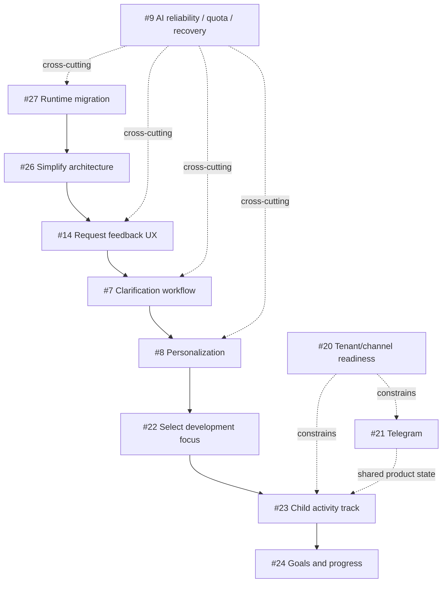

# Product Roadmap — Game of the Day

This document describes the product direction and dependencies between major initiatives. Technical architecture lives in [`architecture.md`](architecture.md); executable work is tracked in GitHub Issues.

## Product vision

```text
useful daily activity
→ listen to caregiver feedback
→ personalize future activities
→ maintain a child activity history
→ support goals and explainable progress
```

The intended value is straightforward: a caregiver chooses what they want to focus on, receives appropriate and safe activities, records what actually happened, and gradually builds a useful history of activities and observations.

The product is not a medical or diagnostic tool.

## V1 — Daily activity delivery

The first version establishes the basic daily loop: select an age-appropriate activity, prepare a delivery message, send it through the configured channel, and persist delivery state.

This responsibility has moved from the legacy Google runtime to the VPS/SQLite runtime: the host has run daily preparation and delivery since 2026-09-18. What remains is retiring the legacy path against the exit criteria in #32; migration status is tracked under #27 and its child issues.

## V2 — Feedback loop

The semantic feedback pipeline is already operational. The remaining work is primarily product UX and reliability hardening.

```text
channel feedback
→ ingress validation
→ durable queue
→ persist raw feedback
→ Feedback Agent
→ persist validated analysis
```

Completed foundations include feedback persistence/linking and provenance-safe semantic analysis. Remaining product work includes explicit post-activity feedback collection (#14), multi-turn clarification (#7), and AI quota/recovery hardening (#9).

`played / not_played`, rating, and free-form observation are deliberately modeled as different facts. A skipped activity is not automatically a negative rating, and lack of feedback is not interpreted as a negative signal.

## V3 — Personalization

Future activity selection should use confirmed product memory rather than raw or ambiguous feedback.

```text
age
+ safety
+ activity history
+ confirmed preferences / observations
+ selected development focus
+ later: active goals
→ next activity
```

Age and safety remain hard constraints and take precedence over user preferences or model suggestions.

Primary initiatives:

- #8 — personalization from confirmed feedback;
- #22 — selectable development focus and skill;
- #15 — replace an already prepared activity when fresh confirmed feedback makes it unsuitable.

## V4 — Child activity and development track

The product state should be independent of the messaging transport.

```text
child profile
  ├── age / birth date
  ├── selected focus
  ├── goals
  ├── activity history
  ├── played / not played
  ├── ratings / feedback
  ├── caregiver observations
  └── progress
```

The key initiative is #23.

Important boundaries:

- child state belongs to `child_id`, not to a VK or Telegram peer;
- changing channels must not reset history;
- caregiver observations remain observations rather than medical conclusions;
- workflow execution state and durable product memory remain separate.

## V5 — Goals and progress

Tracked in #24.

```text
focus / skill
→ goal
→ activities
→ played/not played + observations
→ explainable progress
→ active / achieved / paused
```

An LLM must not declare a goal achieved without confirmed evidence or an explicit deterministic rule.

## Multi-channel delivery

VK is the current user-facing channel. Telegram is planned as an additional full delivery and feedback channel (#21).

Target boundary:

```text
channel connection
→ tenant / family
→ recipient
→ child profile
→ shared product state
```

#20 defines the cross-cutting constraint: transport must not define product identity or product logic.

## Engineering track

The current P0 priority is the controlled runtime migration (#27): move delivery and durable state to the VPS/SQLite contour while preserving rollback and feedback reliability.

After migration stability is established, #26 focuses on simplifying the application structure without changing behavior. This sequencing avoids mixing a storage/runtime migration with a structural refactor.

```text
#27 runtime migration
→ stability period
→ #26 architecture simplification
→ #14 feedback request UX
→ #7 clarification workflow
→ #8 personalization
```

#9 remains a parallel reliability track.

A multi-agent harness or model router (#10) is deliberately deferred until there is a demonstrated orchestration or provider-routing problem. Additional architecture is not a goal by itself.

## Dependency map



## Near-term priority

```text
NOW:
#27 complete controlled VPS/SQLite migration

THEN:
#26 architecture simplification
→ #14 feedback request UX
→ #7 clarification workflow
→ #8 personalization

NEXT PRODUCT LAYER:
#22 selectable focus
→ #23 child activity track
→ #24 goals/progress
```

Telegram (#21) is a channel-expansion initiative and must reuse the same product state rather than creating a separate data silo.

## Explicit non-goals for the current stage

- no premature microservice migration;
- no separate database technology solely for hypothetical scale;
- no orchestration framework without a demonstrated need;
- no additional agents simply to increase agent count;
- no product features hidden inside infrastructure/refactoring work;
- no automatic paid AI or infrastructure overage;
- no medical or diagnostic interpretation of child observations.
